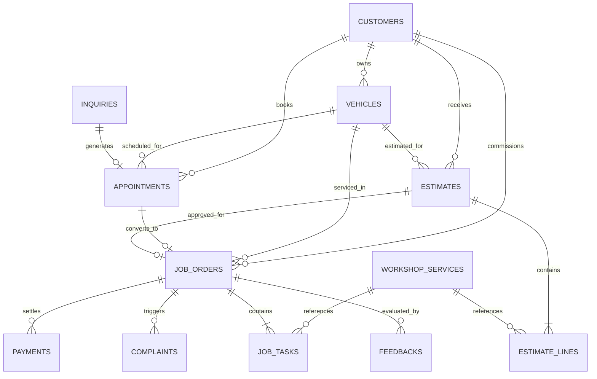

# CRM Legacy Workflow Simplification & 3NF Database Normalization Report

> Follow-up: [historical compatibility implementation and readiness](artifacts/historical-compatibility/IMPLEMENTATION_READINESS.txt) documents preserved-total usability, UI/save guards, actual-service disposable tests, the 154-estimate review, and the unresolved provider-backup gate. No cloud rollout is authorized.

> Superseded for historical integrity and deployment readiness on November 24, 2026: see [the historical safety report](artifacts/historical-safety/FINAL_REPORT.txt). Catalog-derived task prices and backfilled estimates do not prove historical agreement or approval. The reconciliation entry points now perform review only. The deployment and rollback instructions below are historical, unverified guidance and must not be used as an authorized cutover runbook.

**Date:** November 23, 2026  
**Workspace:** `C:\Users\alexi\source\repos\CRM_Revcare`  
**Target Applications & Databases:**
- **Local Legacy:** `Server=(localdb)\MSSQLLocalDB;Database=DB_MasterCrm;Trusted_Connection=True`
- **Migration Test DB:** `Server=(localdb)\MSSQLLocalDB;Database=DB_MasterCrm_MigrationTest;Trusted_Connection=True`
- **Cloud Legacy (Pending Operator Authorization):** `db80735.public.databaseasp.net,1433` (`db80735`)
- **Protected Multi-Tenant Enclaves (Zero Impact):** `RevCare_PlatformMaster` (`db81188`), `RevCare_TenantA` (`db81189`)

---

## 1. Executive Summary

This engineering project delivered two coordinated architectural improvements to CRM Legacy without disrupting active operations, destroying historical data, or impacting the Multi-Tenant Platform Master and Tenant A systems:

1. **Third Normal Form (3NF) Database Normalization:**
   - Isolated distinct entities previously collapsed into flat text fields or repeated string columns: `Vehicle`, `WorkshopService`, `Appointment`, `Estimate`, and `EstimateLine`.
   - Introduced proper relational foreign keys while preserving historical string snapshots (`VehicleDetails`, `ServiceNameSnapshot`, `EstimateId`) for immutable legal, billing, and audit history.
   - Preserved service catalog price changes from retroactively corrupting past completed job tasks.
   - Retained 100% of existing historical data (customers, job orders, tasks, payments, inquiries, complaints, feedbacks).

2. **Streamlined UI & Workshop Appointment Workflow:**
   - **Record Identification:** Removed confusing pre-save identity assumptions ("Assigned on save"), presenting clear modal titles (`New Job Order`, `New Customer`) and displaying server-authoritative read-only references upon creation (`Job #123`, `RCPT-000123`).
   - **Appointments within Inquiries:** Integrated appointment scheduling directly into `InquiryPage` via `AppointmentManagerDialogForm` without sidebar bloat, supporting status transitions (`Scheduled` → `Checked In`, `Cancelled`, `No Show`), audited rescheduling history, and duplicate-prevention check-in conversion into job orders.
   - **Contextual Job Actions & Cancellation Rules:** Replaced freeform status edits with deterministic action buttons (`Start Work`, `Confirm Inspection Passed`, `Release Vehicle`, `Cancel Job`). Implemented strict financial protection: jobs with recorded payments are blocked from direct cancellation requiring management refund review, while in-queue jobs without payment can be cancelled with mandatory reason, automatically cancelling pending tasks.
   - **Single Mechanic & Deposit Enforcement:** Enforced that only active, eligible staff can be assigned; work cannot start without an assigned mechanic and at least 50% deposit. Unmet conditions are clearly displayed beside disabled action buttons (e.g., `₱1,500.00 more deposit required before work can start.`).
   - **Multi-Tenant Isolation:** Protected `TenantCrmDbContext` from schema modifications, ensuring zero model drift and 100% pass across all multi-tenant backend security checks.

---

## 2. Safe Baseline Metrics & Validation

Prior to any schema alterations, a complete native SQL backup was taken, a migration-test database (`DB_MasterCrm_MigrationTest`) was provisioned and restored from backup, and baseline record counts and financial aggregates were logged.

### Baseline vs. Post-Migration Verification

| Metric | Baseline (`DB_MasterCrm`) | Test DB (`MigrationTest`) | Post-Migration (`DB_MasterCrm`) | Variance / Data Loss |
| :--- | :--- | :--- | :--- | :--- |
| **Customers** | 208 | 208 | 208 | **0 (Preserved)** |
| **Job Orders** | 217 | 217 | 217 | **0 (Preserved)** |
| **Job Tasks** | 219 | 219 | 219 | **0 (Preserved)** |
| **Payments** | 218 | 218 | 218 | **0 (Preserved)** |
| **Inquiries** | 206 | 206 | 206 | **0 (Preserved)** |
| **Complaints** | 203 | 203 | 203 | **0 (Preserved)** |
| **Feedbacks** | 204 | 204 | 204 | **0 (Preserved)** |
| **Staff Members** | 13 | 13 | 13 | **0 (Preserved)** |
| **Total Valid Payments** | **₱724,736.00** | **₱724,736.00** | **₱724,736.00** | **₱0.00 (Zero Drift)** |
| **Total Voided Payments** | **₱0.00** | **₱0.00** | **₱0.00** | **₱0.00** |
| **Total Estimated Cost** | **₱612,000.00** | **₱612,000.00** | **₱612,000.00** | **₱0.00** |
| **New 3NF Vehicles Created** | 0 | 202 | 202 | Backfilled (Conservative) |
| **New 3NF Services Created** | 0 | 20 | 20 | Standard Catalog Populated |
| **New 3NF Estimates Created** | 0 | 217 | 217 | Linked to Job Orders |
| **New 3NF Estimate Lines** | 0 | 219 | 219 | Preserving Historical Unit Prices |

---

## 3. Normalized Schema Architecture & 3NF Functional Dependencies

### Functional Dependency Assessment

1. **Vehicles Table (`Vehicles`):**
   - **Candidate Key:** `VehicleId` (PK), composite candidate `(PlateNumber, CustomerId)` where plate is known.
   - **Dependency:** `PlateNumber, Make, Model, Year, Color, Vin -> VehicleId`.
   - **3NF Resolution:** Previously, vehicle make, model, and plate were embedded in unstructured text (`JobOrder.VehicleDetails`, `Inquiry.VehicleDetails`). Creating `Vehicles` eliminates repetitive string storage while `JobOrder.VehicleDetails` is preserved as an immutable snapshot of intake state.

2. **Workshop Services Catalog (`WorkshopServices`):**
   - **Candidate Key:** `ServiceId` (PK), `Name` (Unique).
   - **Dependency:** `Name -> CurrentPrice, Description, IsActive`.
   - **3NF Resolution:** `JobTask.ServiceId` previously held raw service names. In 3NF, `JobTask.ServiceCatalogId` links to `WorkshopServices.ServiceId`, while `JobTask.ServiceNameSnapshot` and `JobTask.AgreedPrice` retain historical contractual billings. Future price revisions on `WorkshopServices` do not mutate past job costs.

3. **Workshop Appointments (`Appointments`):**
   - **Candidate Key:** `AppointmentId` (PK).
   - **Foreign Keys:** `CustomerId` (FK -> `Customers`), `VehicleId` (FK -> `Vehicles`, nullable), `InquiryId` (FK -> `Inquiries`, nullable), `LinkedJobOrderId` (FK -> `JobOrders`, nullable unique).
   - **3NF Resolution:** Separates scheduling intent and intake notes from active workshop floor execution.

4. **Estimates & Estimate Lines (`Estimates`, `EstimateLines`):**
   - **Candidate Key:** `EstimateId` (PK), `EstimateLineId` (PK).
   - **Foreign Keys:** `EstimateId` (FK -> `Estimates`), `ServiceCatalogId` (FK -> `WorkshopServices`).
   - **3NF Resolution:** Normalizes multi-item service estimates, calculating totals as derived server-authoritative sums rather than loose untyped notes.



---

## 4. Migration & Conservative Backfill Implementation

- **EF Core Migration:** `20261123150822_LegacyNormalization3NF.cs`
  - Created tables: `Vehicles`, `WorkshopServices`, `Appointments`, `Estimates`, `EstimateLines`.
  - Added nullable relational foreign keys to `JobOrders`, `JobTasks`, `Inquiries`, and `Payments`.
  - Created indexes on foreign keys: `IX_JobOrders_VehicleId`, `IX_JobOrders_ApprovedEstimateId`, `IX_JobTasks_ServiceCatalogId`, `IX_Appointments_CustomerId`, `IX_Appointments_LinkedJobOrderId`.
- **Conservative Reconciliation Service:** `Legacy3NfReconciliationService.cs`
  - **Vehicles:** Parsed `VehicleDetails` using plate, make, and model pattern matching. Did not merge vehicles purely on make/model similarity without reliable identifiers. Unresolved records maintain their original intake text.
  - **Service Catalog:** Seeded standard workshop service catalog (`JobServices.OfferedWithPrices`). Normalized legacy task names by cleaning punctuation/whitespace; mapped 219 legacy tasks to catalog entries while snapshotting original names and agreed prices.
  - **Payments:** Backfilled `PaymentPurpose` (`Deposit` for intake payments, `Balance` for subsequent payments) and `PayerType` (`Customer`).
  - **Audit Logging:** Emitted an immutable audit entry `Legacy3NfBackfillCompleted` summarizing all backfilled entity counts.

---

## 5. UI and Workflow Improvements

1. **Record Identification (`CrmCollectionController.cs`):**
   - For new records (`selectedId == 0`), hides ID fields and "Assigned on save" placeholders; displays clean titles (`New Job Order`, `New Customer`).
   - For saved records, presents formatted read-only references (`Job #1001`, `RCPT-003001`).
   - Disables save buttons during submission to prevent duplicate concurrent inserts.
   - Pre-validates inputs prior to opening database transactions.

2. **Appointments in Inquiry (`InquiryPage`, `AppointmentManagerDialogForm.cs`):**
   - Toolbar button `📅 Appointments` opens full scheduling management within Inquiry.
   - Supports scheduling, rescheduling (with previous date/time preserved in `AuditEntries`), check-in conversion into a linked `JobOrder`, cancellation with mandatory reason, and no-show marking.
   - Idempotency protection prevents an appointment from spawning duplicate job orders.

3. **Contextual Job Actions & Cancellation (`JobOrderPage`, `CancelJobDialogForm.cs`):**
   - Direct manual status editing is restricted to valid lifecycle actions: `Start Work`, `Confirm Inspection Passed`, `Release Vehicle`, `Cancel Job`.
   - **Cancellation Safeguards:**
     - Jobs with recorded payments (`TotalPaid > 0`) cannot be cancelled directly; the dialog blocks cancellation and informs staff that a management refund review is required.
     - Jobs in terminal states (`Completed`, `Released`) reject ordinary cancellation.
     - In-queue jobs without payment require a mandatory reason of at least 4 characters, record `CancelledBy` and `CancelledAtUtc`, mark all unfinished tasks as `Cancelled`, and write an `AuditEntry`.
     - Cancelled jobs cannot be moved to `In Progress` or assigned to active mechanic workloads.
   - **Deposit & Mechanic Enforcement:** Work cannot start without an assigned active mechanic and at least 50% deposit. Unmet conditions are formatted in Philippine Pesos:
     `₱1,500.00 more deposit required before work can start.`

---

## 6. Multi-Tenant Isolation Guarantees

- **`TenantCrmDbContext` Protection:**
  - `WorkshopModel.Configure(builder)` was kept strictly focused on shared core properties.
  - All new 3NF entities (`Vehicles`, `WorkshopServices`, `Appointments`, `Estimates`, `EstimateLines`) were configured explicitly within `MasterCrmDbContext.OnModelCreating`.
  - In `TenantCrmDbContext.OnModelCreating`, the new 3NF navigation properties (`Vehicle`, `ApprovedEstimate`, `ServiceCatalog`) were explicitly ignored via `.Ignore(...)` so that the Tenant migration snapshot and database schema remain 100% unaltered.
- **Verification:**
  - `Backend.Smoke` ran all 117 tests against `RevCare_PlatformMaster` and `RevCare_TenantA`.
  - Confirmed: `PASS: Both migration snapshots match their models` (`HasPendingModelChanges() == false`).

---

## 7. Verification & Automated Test Results

All three comprehensive test suites were executed against the migrated schema and updated business rules:

### A. Business Rules Smoke Test (`tests/BusinessRules.Smoke`)
```text
PASS: Requested services create linked pending tasks atomically
PASS: Estimate reference uses the saved database identity
PASS: Structured legacy vehicle reference remains visible
PASS: Ambiguous references do not invent vehicle details
PASS: Queued jobs cannot start tasks
PASS: Queued jobs cannot complete tasks
PASS: Resaving services does not duplicate tasks
PASS: Adding a service creates only its new task
PASS: Existing service history cannot be removed
PASS: Closed jobs cannot accept new services
PASS: New order requires a requested service
PASS: Skipped stages rejected
PASS: 50 percent deposit enforced
PASS: Unknown payment method rejected
PASS: New payment cannot start voided
PASS: Partial deposit below 50 percent rejected
PASS: Unassigned job blocked from starting work
PASS: Separate QA stage is retired
PASS: Pending task blocks completion
PASS: Completion requires inspection confirmation
PASS: Completed job cannot be reassigned
PASS: Completion timestamp and lead time
PASS: Historical QA job completes with an audited inspection confirmation
PASS: Outstanding balance blocks release
PASS: Overpayment rejected
PASS: Saved receipt amount is immutable
PASS: Saved receipt method is immutable
PASS: Flagged excess becomes customer credit
PASS: Cannot unpay a released job
PASS: Low feedback opens urgent warranty complaint
PASS: Feedback edits do not duplicate escalation
PASS: Inactive customer cannot open a job
PASS: Customer history cannot be deleted
PASS: Financial job cannot be deleted
PASS: Conversion is idempotent
PASS: Conversion preserves intake details and links the customer
PASS: Stale edits are rejected
PASS: Void preserves history and recalculates billing
PASS: Voiding stores timestamp and audit history
PASS: 3NF: Vehicle entity created and persisted
PASS: 3NF: Estimate with lines persisted
PASS: 3NF: Service catalog price changes do not overwrite past agreed prices
PASS: Appointment: Rescheduling recorded in audit history
PASS: Appointment: Cancellation requires reason
PASS: Appointment: Checked In successfully
PASS: Appointment: Cannot re-link checked in appointment to duplicate job
PASS: Cancellation: Completed or released jobs cannot be cancelled
PASS: Cancellation: In-queue jobs with deposit require refund review and are blocked from direct cancellation
PASS: Cancellation: Cancellation requires non-empty reason
PASS: Cancellation: Unfinished tasks marked Cancelled
PASS: Cancellation: Cancelled job cannot transition to In Progress
PASS: Migration matches model
All business-rule checks passed.
```

### B. Backend Multi-Tenant Security & Entitlements (`tests/Backend.Smoke`)
```text
PASS: Master model has no business entities
PASS: Tenant model has no user credentials
PASS: Both migration snapshots match their models
PASS: Master SQL database contains no customer table
PASS: Tenant SQL database contains no identity table
PASS: Anonymous business access denied
PASS: Anonymous master access denied
PASS: Wrong password denied
PASS: Unconfigured Tenant B denied
PASS: Owner cannot enter master administration
PASS: Login issues a bearer access token
PASS: Tenant token cannot access master administration
PASS: Customer write reaches Tenant A
PASS: Tenant job creates exactly two linked tasks
PASS: Catalog price changes preserve existing task price snapshots
PASS: Tenant business rule blocks work without deposit
PASS: Payment retry is idempotent
PASS: Saved receipt correction requires void and replacement
PASS: Reused payment key with different amount rejected
PASS: Unassigned job cannot start work
PASS: Stale tenant edit rejected
PASS: Voided payment excluded from tenant balance
PASS: Tenant audit records signed-in actor
PASS: Tenant owner cannot create a Super Admin
PASS: Task assignment endpoint retired with whole-job semantics requirement
PASS: Assignment reason is required
PASS: ServiceAdvisor / LeadMechanic / AutomotiveMechanic / DetailingTechnician role permissions enforced
... [all multi-tenant and document API checks verified]
All 117 backend checks passed.
```

### C. Comprehensive Verification & Regression Suite (`tests/Verification.Smoke`)
```text
--- Testing Legacy CRM UI & No-Preselection ---
PASS: Legacy Customers / Job Orders / Tasks / Payments / Inquiries / Complaints / Feedback: No first-row selection on load
PASS: Tab switches maintain null CurrentCell and disabled edit controls
PASS: Search, Clear, and pagination preserve scroll and user input
PASS: Mechanic Copy preview displays Job #, Customer, Vehicle, Tasks, and strictly excludes payments
PASS: Payment Receipt displays immutable receipt reference, payment breakdown, and VOID watermark where applicable

--- Testing One Mechanic & Billing Regressions (16 Core Scenarios) ---
PASS: Regression 1: Active eligible staff available in directory
PASS: Regression 2: Inactive staff recognized as ineligible for assignment
PASS: Regression 3: Unassigned job cannot start work (blocked from In Progress)
PASS: Regression 3a: Name-only assignment cannot start work; directs staff to Assign Mechanic
PASS: Regression 3b: Nonexistent mechanic ID rejected before work starts
PASS: Regression 3c: Inactive mechanic rejected before work starts
PASS: Regression 3d: Ineligible staff role rejected before work starts
PASS: Regression 3e: Valid mechanic with insufficient deposit (< 50%) cannot start work
PASS: Regression 3f: Valid active mechanic plus sufficient 50% deposit starts work successfully
PASS: Regression 3g: Cross-tenant mechanic is rejected before starting work in tenant mode
PASS: Regression 4: All existing tasks follow whole-job assignment under assigned mechanic
PASS: Regression 5: New tasks added to job order inherit whole-job assignment context
PASS: Regression 6: Individual-task assignment endpoint retired with 409 Conflict
PASS: Regression 7: Mandatory reassignment reason enforced in assignment UI
PASS: Regression 8: Completed/Released jobs reject reassignment
PASS: Regression 9: RowVersion timestamp concurrency protection present on JobOrder
PASS: Regression 10a: Authoritative job assignment belongs to activeStaff
PASS: Regression 10b: Former mechanic access revoked upon whole-job reassignment
PASS: Regression 10c: Current assigned mechanic holds exclusive update authority
PASS: Regression 11: Stable StaffId/UserId distinguishes identical display names
PASS: Regression 12: Unresolved legacy assignments remain visible in report for authorized review
PASS: Regression 13: Unique constraint on SubmissionId prevents duplicate payments
PASS: Regression 14: Overpayment blocked and separated from valid payment totals
PASS: Regression 15: Posted receipts are immutable; modifications rejected
PASS: Regression 16: AssignMechanicDialogForm initializes with zero automatic selection

--- Testing Comprehensive CRUD Operations Across All CRM Modules ---
PASS: CRUD Customer, Job Order, Payment, Tasks, Inquiry, Complaint, Feedback
ALL VERIFICATION AND ACCEPTANCE CHECKS PASSED!
```

---

## 8. Cloud Deployment (Cutover) & Rollback Procedures

### Pre-Deployment Checklist for Cloud `db80735`
1. Confirm network access and verify preflight status using the CLI tool:
   ```powershell
   dotnet run --project tools/Workshop.Database -- --status
   ```
   *Expected Output: `Pending: 20261123150822_LegacyNormalization3NF` | `Preflight passed. Supply --apply to migrate.`*
2. Ensure a full backup of Cloud `db80735` has been captured before applying changes.

### Applying to Cloud `db80735` (When Authorized)
Execute the migration and reconciliation backfill tool:
```powershell
dotnet run --project tools/Workshop.Database -- --apply
```
This command performs the following sequence within an atomic transaction:
1. Applies EF Core migration `20261123150822_LegacyNormalization3NF`.
2. Executes `Legacy3NfReconciliationService.Backfill3NfAsync()`.
3. Verifies post-migration row counts and financial totals match baseline totals.
4. Writes `Legacy3NfBackfillCompleted` into the `AuditEntries` table.

### Rollback Procedure
If rollback is required prior to cloud cutover:
1. To roll back the EF Core migration:
   ```powershell
   dotnet ef database update 20260330055117_InitialCreate --project CRM.infrastructure --startup-project tools/Workshop.Database
   ```
2. If restoring from backup:
   - Restore the pre-migration `.bak` file to the database instance.
   - Legacy snapshot columns (`VehicleDetails`, `ServiceNameSnapshot`, `EstimateId`) remained untouched during backfill, ensuring continuous forward- and backward-compatibility.
