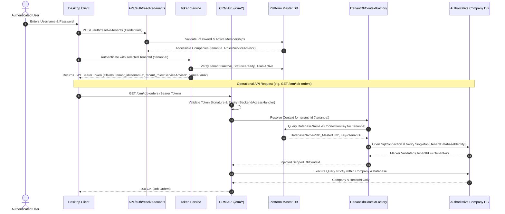
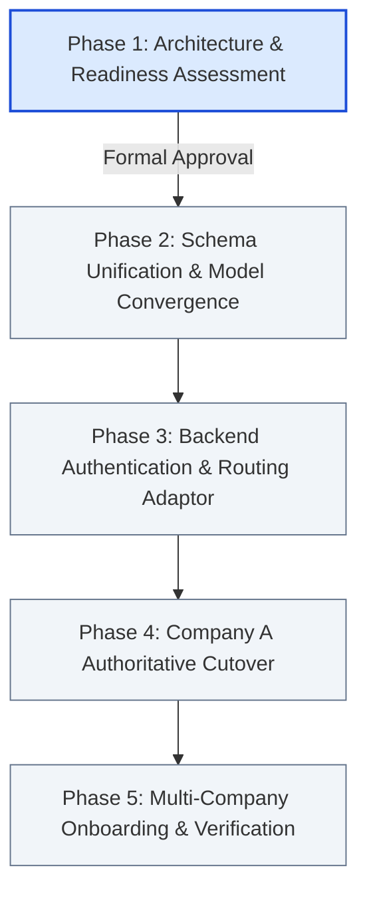

# RevCare CRM — Phase 1: Legacy-to-Tenant A Transition and Multi-Company Architecture Specification

**Document Version:** 1.0.0 (Phase 1 Architecture & Readiness Assessment)  
**Date:** November 2026  
**Author:** Senior Software Architect, Database Architect, and Multi-Tenant Security Specialist  
**Target Solution:** RevCare Auto Hub CRM (.NET 10, ASP.NET Core Web API, EF Core, SQL Server LocalDB, Windows Forms)  
**Workspace:** `C:\Users\alexi\source\repos\CRM_Revcare`  
**Target Environment:** Local Development `(localdb)\MSSQLLocalDB`

---

## 1. Executive Summary & New Architectural Decision

### 1.1 The Architectural Decision
RevCare Auto Hub CRM is transitioning from a standalone single-tenant legacy desktop application into a **Multi-Company, Multi-Tenant SaaS Architecture** powered by a single shared application codebase with **strictly isolated, independent company databases**.

Key architectural pillars:
1. **CRM Legacy becomes Company A (`tenant-a`):** The fully hardened, transactional workshop engine running on `DB_MasterCrm` represents the authoritative operational system of Company A (**RevCare Auto Hub**).
2. **Three Distinct Automotive Companies:**
   - **Company A (`tenant-a`):** RevCare Auto Hub (Single-shop operation, Plan A Starter/Core).
   - **Company B (`tenant-b`):** Independent automotive company (Single-shop operation, Plan B Professional with Business Intelligence).
   - **Company C (`tenant-c`):** Independent multi-branch automotive company (Multi-branch enterprise operation on a single company database, Plan C Enterprise).
3. **Strict Physical Database Isolation:** Operational records (customers, vehicles, staff, catalogs, inquiries, appointments, estimates, job orders, tasks, payments, feedback, complaints, refunds, and archives) are **never shared** between Company A, Company B, and Company C.
4. **Tenant C Multi-Branching in a Single Database:** Company C operates multiple physical branches (`MAIN`, `NORTH`, `SOUTH`) within its single dedicated database (`RevCare_TenantC`), partitioned by relational branch ownership (`BranchId`).
5. **Centralized Platform Administration:** A dedicated platform database (`RevCare_PlatformMaster`) manages central authentication, company registrations, user memberships, subscription entitlements, module licensing, and technical auditing. Super Admins manage platform metadata only and possess **zero** implicit access to company operational or financial records.
6. **Unified Operational Engine:** Rather than maintaining segregated codebases or degrading Company A to an early prototype schema, the application converges on a unified operational model inheriting the complete workshop transaction hardening, 3NF normalization, and archiving capabilities of CRM Legacy.

---

## 2. Actual Local Database Inventory & Baseline Audit

All active databases reside locally on SQL Server instance `(localdb)\MSSQLLocalDB`. An exhaustive audit of existing tables, record counts, and migration histories was executed:

```
+--------------------------------------------------------------------------------------------------------------------+
|                                      REVCARE LOCAL DATABASE INVENTORY & BASELINE                                    |
+--------------------------+-----------------------+-------------+-------------+-------------------------------------+
| Database Name            | Logical Role          | Plan Tier   | Records     | Migration Baseline                  |
+--------------------------+-----------------------+-------------+-------------+-------------------------------------+
| RevCare_PlatformMaster   | Central Master Admin  | Platform    | 4 Users     | 20261124062726_AddSubscriptionPlans |
|                          |                       |             | 3 Tenants   | (4 applied migrations)              |
|                          |                       |             | 3 Members   |                                     |
+--------------------------+-----------------------+-------------+-------------+-------------------------------------+
| DB_MasterCrm             | Company A (Auth.)     | Plan A      | 220 Jobs    | 20261124100231_AddJobOrderArchiving |
|                          | RevCare Auto Hub      | (Starter)   | 209 Cust    | (12 applied migrations)             |
|                          |                       |             | 202 Veh     |                                     |
|                          |                       |             | 223 Pay     |                                     |
+--------------------------+-----------------------+-------------+-------------+-------------------------------------+
| RevCare_TenantA          | Prototype Sandbox     | Plan A      | 1 Job       | 20261124062717_AddTenantBranchFound |
|                          | (Cold Snapshot)       | (Test)      | 1 Cust      | (7 applied migrations)              |
|                          |                       |             | 1 Pay       |                                     |
+--------------------------+-----------------------+-------------+-------------+-------------------------------------+
| RevCare_TenantB          | Company B             | Plan B      | 0 Jobs      | 20261124062717_AddTenantBranchFound |
|                          | Independent Shop      | (Pro BI)    | 0 Cust      | (7 applied migrations)              |
|                          |                       |             | 1 Branch    |                                     |
+--------------------------+-----------------------+-------------+-------------+-------------------------------------+
| RevCare_TenantC          | Company C             | Plan C      | 0 Jobs      | 20261124062717_AddTenantBranchFound |
|                          | Multi-Branch Ent.     | (Enterprise)| 0 Cust      | (7 applied migrations)              |
|                          |                       |             | 3 Branches  |                                     |
+--------------------------+-----------------------+-------------+-------------+-------------------------------------+
```

### 2.1 Detailed Table and Record Comparison

| Entity / Table | `DB_MasterCrm` (Company A) | `RevCare_TenantA` (Prototype) | `RevCare_TenantB` (Company B) | `RevCare_TenantC` (Company C) | Schema Status & Compatibility |
| :--- | :---: | :---: | :---: | :---: | :--- |
| **`JobOrders`** | **220** | 1 (Test) | 0 | 0 | Compatible; `DB_MasterCrm` has archiving columns (`IsArchived`, etc.) |
| **`JobTasks`** | **229** | 0 | 0 | 0 | Compatible; `DB_MasterCrm` has archiving columns (`IsArchived`, etc.) |
| **`Customers`** | **209** | 1 (Test) | 0 | 0 | Compatible schema (`FullName`, `ContactNumber`, `Email`, etc.) |
| **`Vehicles` (3NF)** | **202** | *Table Missing* | *Table Missing* | *Table Missing* | Present in `DB_MasterCrm`; ignored in `TenantCrmDbContext` |
| **`Estimates` (3NF)** | **217** | *Table Missing* | *Table Missing* | *Table Missing* | Present in `DB_MasterCrm`; ignored in `TenantCrmDbContext` |
| **`EstimateLines`** | **217** | *Table Missing* | *Table Missing* | *Table Missing* | Present in `DB_MasterCrm`; ignored in `TenantCrmDbContext` |
| **`Appointments`** | **1** | *Table Missing* | *Table Missing* | *Table Missing* | Present in `DB_MasterCrm`; ignored in `TenantCrmDbContext` |
| **`AppointmentHistories`** | **1** | *Table Missing* | *Table Missing* | *Table Missing* | Present in `DB_MasterCrm`; ignored in `TenantCrmDbContext` |
| **`JobCancellationRequests`** | **0** | *Table Missing* | *Table Missing* | *Table Missing* | Present in `DB_MasterCrm`; ignored in `TenantCrmDbContext` |
| **`Refunds`** | **0** | *Table Missing* | *Table Missing* | *Table Missing* | Present in `DB_MasterCrm`; ignored in `TenantCrmDbContext` |
| **`Payments`** | **223** | 1 (Test) | 0 | 0 | Compatible core fields (`AmountPaid`, `PaymentMethod`, etc.) |
| **`Inquiries`** | **207** | 0 | 0 | 0 | Compatible schema |
| **`Feedbacks`** | **204** | 0 | 0 | 0 | Compatible schema |
| **`Complaints`** | **203** | 0 | 0 | 0 | Compatible schema |
| **`Staff`** | **15** | 1 (`owner`) | 1 (`owner_b`) | 1 (`owner_c`) | `DB_MasterCrm` uses `StaffId` string; Tenant uses `UserId` GUID |
| **`Branches`** | *Table Missing* | 1 (`MAIN`) | 1 (`MAIN`) | 3 (`MAIN`, `NORTH`, `SOUTH`) | Present in Tenant schema; missing in `DB_MasterCrm` |
| **`TenantDatabaseIdentity`** | *Table Missing* | 1 (`tenant-a`) | 1 (`tenant-b`) | 1 (`tenant-c`) | Present in Tenant schema; missing in `DB_MasterCrm` |

---

## 3. Schema Compatibility Findings: `MasterCrmDbContext` vs `TenantCrmDbContext`

A deep comparative code analysis between `CRM.infrastructure.data.MasterCrmDbContext` and `CRM.infrastructure.data.TenantCrmDbContext` reveals structural divergence resulting from iterative development:

```
       MasterCrmDbContext (Superset)                       TenantCrmDbContext (Subset Prototype)
  +-------------------------------------+             +-------------------------------------+
  | - Customers                         |             | - Customers                         |
  | - Vehicles (3NF Relational)         |             | - VehicleInfo (flat string only)    |
  | - Estimates & EstimateLines (3NF)   |             | - Estimates (Ignored)               |
  | - Appointments & Histories          |             | - Appointments (Ignored)            |
  | - JobCancellationRequests & Refunds |             | - Refunds / Cancellations (Ignored) |
  | - JobOrder / Task Archiving Columns |             | - Archiving Columns (Ignored)       |
  | - WorkshopStaff (Username / Role)   |             | - TenantStaff (GUID UserId)         |
  | - Direct AssignedMechanicUserId     |             | - TaskAssignment / TaskReview / Work|
  | - Full WorkshopRules Hardening      |             | - Branches (TenantBranch)           |
  | - IdentityDbContext (Local Auth)    |             | - TenantDatabaseIdentity (Singleton)|
  +-------------------------------------+             +-------------------------------------+
```

### Key Compatibility Findings:
1. **`MasterCrmDbContext` is a Feature Superset:** `MasterCrmDbContext` contains the complete production-grade data model: 3NF relational vehicles, formal estimate lines, appointment check-in with `WITH (UPDLOCK, HOLDLOCK)`, full cancellation review and refund management, and soft-archiving with audit trail preservation.
2. **`TenantCrmDbContext` Explicitly Ignores Key Entities:**
   Lines 40-43 of `TenantCrmDbContext.cs` actively ignore relational navigation properties:
   ```csharp
   builder.Entity<JobOrder>().Ignore(x => x.VehicleId).Ignore(x => x.Vehicle)
       .Ignore(x => x.ApprovedEstimateId).Ignore(x => x.ApprovedEstimate)
       .Ignore(x => x.CancelledAtUtc).Ignore(x => x.CancellationReason).Ignore(x => x.CancelledBy);
   builder.Entity<JobTask>().Ignore(x => x.ServiceCatalogId).Ignore(x => x.ServiceCatalog)
       .Ignore(x => x.AgreedPrice).Ignore(x => x.ServiceNameSnapshot);
   ```
3. **Staff Keying Discrepancy:**
   - In `MasterCrmDbContext`, `Staff.StaffId` is stored as an alphanumeric slug (e.g. `juan.gomez`, `carlos.ramos`, `pedro.santos`) with role, specialty, and active status.
   - In `TenantCrmDbContext`, `Staff.UserId` is stored as an ASP.NET Identity GUID string linked to `PlatformMasterDbContext.AspNetUsers`.
4. **Multi-Branching & Database Identity Discrepancy:**
   - `TenantCrmDbContext` possesses the `Branches` table (`BranchId`, `BranchCode`, `BranchName`, `IsActive`) and the `TenantDatabaseIdentity` singleton table (`Id = 1, TenantId = ...`).
   - `MasterCrmDbContext` lacks these two tables because Company A historically operated as a single-branch workshop.

---

## 4. Evaluation of Transition Approaches: Option 1 vs. Option 2

The specification mandates evaluating two transition approaches based on technical evidence:

### Option 1: Register `DB_MasterCrm` Directly as Company A's Authoritative Database
- **Execution Mechanism:**
  1. In `RevCare_PlatformMaster.dbo.Tenants`, update Company A's record (`TenantId = 'tenant-a'`) to point directly to `DatabaseName = 'DB_MasterCrm'`.
  2. Apply an additive, non-breaking schema update to `DB_MasterCrm` adding:
     - `TenantDatabaseIdentity` (single row: `Id = 1, TenantId = 'tenant-a'`).
     - `Branches` (single default row: `BranchId = 1, BranchCode = 'MAIN', BranchName = 'RevCare Auto Hub - Main Branch'`).
     - Nullable `BranchId` foreign key on `JobOrders`, `Appointments`, and `Payments` defaulted to `1`.
  3. Freeze and retire the prototype database `RevCare_TenantA` (retained as read-only cold backup `RevCare_TenantA_Baseline.bak`).
  4. Point `CRM.api`'s connection key for Tenant A to `DB_MasterCrm`.

### Option 2: Migrate Operational Records from `DB_MasterCrm` into `RevCare_TenantA`
- **Execution Mechanism:**
  1. Write an ETL script to extract 220 Job Orders, 209 Customers, 202 Vehicles, 229 Job Tasks, 223 Payments, etc., from `DB_MasterCrm`.
  2. Attempt to transform and load these records into `RevCare_TenantA`.

### Technical Comparison Matrix

| Technical Evaluation Criterion | Option 1: Register `DB_MasterCrm` Directly | Option 2: ETL Migration into `RevCare_TenantA` | Architectural Verdict |
| :--- | :--- | :--- | :--- |
| **Operational Record Preservation** | **100% Guaranteed:** Zero record relocation; all 220 jobs, 209 customers, and 223 payments remain undisturbed. | **High Risk:** Potential truncation or omission of records during transformation. | **Option 1 Wins** |
| **Relational Integrity (3NF)** | **Preserved:** Full 3NF `Vehicles`, `Estimates`, and `Appointments` remain intact. | **Severe Degradation:** `RevCare_TenantA` schema lacks `Vehicles`, `Estimates`, and `Refunds`. Data would be lost or flattened. | **Option 1 Wins** |
| **Primary Key / Identity Collision** | **Zero Collision:** Existing IDs (`JobOrderId 1..220`, `CustomerId 1..209`) are already sequenced and stable. | **Collisions Occur:** `RevCare_TenantA` already has `CustomerId = 1`, `JobOrderId = 1`, `PaymentId = 1`. Violates identity stability rules. | **Option 1 Wins** |
| **Audit Trail & Timestamps** | **100% Intact:** All historical UTC timestamps and audit logs remain historically authentic. | **Risk of Timestamp Corruption:** Inserting across contexts may alter generated identity seeds and audit sequences. | **Option 1 Wins** |
| **Archival Feature Compatibility** | **Fully Compatible:** `IsArchived`, `ArchivedAtUtc`, `ArchivedBy`, and `ArchiveReason` already exist on `DB_MasterCrm`. | **Incompatible:** Archiving columns do not exist in `RevCare_TenantA`'s current migration state. | **Option 1 Wins** |
| **Downtime & Transition Risk** | **Near-Zero Downtime:** Metadata reconfiguration in Platform Master; no heavy data copying. | **High Downtime:** Complex multi-table transactional copy requiring manual foreign key re-mapping. | **Option 1 Wins** |
| **Single Writable Database Rule** | **Enforced:** Exactly one authoritative database for Company A (`DB_MasterCrm`). Prototype retired. | **Risk of Split-Brain:** Running ETL while desktop is active risks divergent writes. | **Option 1 Wins** |

### Senior Architect Recommendation: **OPTION 1 IS DEFINITIVELY RECOMMENDED**
Option 1 is the only technically defensible path. `DB_MasterCrm` is already the true production database holding the complete, hardened business dataset. Migrating into `RevCare_TenantA` would destroy relational 3NF vehicle/estimate linkages, corrupt primary key identities, and strip archival metadata. Under Option 1, `DB_MasterCrm` becomes the authoritative writable database for Company A, `RevCare_TenantA` is safely retired to cold backup, and Company A achieves full multi-tenant integration with zero data loss.

---

## 5. Shared Operational Application Architecture

To avoid maintaining separate copies of the same business logic for Tenant A, Tenant B, and Tenant C, the system architecture must converge on a **Unified Operational Foundation**:

```
+----------------------------------------------------------------------------------------------------+
|                                    SHARED APPLICATION ARCHITECTURE                                  |
+----------------------------------------------------------------------------------------------------+
|                                      Desktop Client / WinForms                                     |
|               [ TenantWorkspaceForm ]  /  [ CrmTransactionsForm (Adapted for Tenant API) ]         |
+-------------------------------------------------+--------------------------------------------------+
                                                  | HTTPS / JWT Bearer Tokens
                                                  v
+----------------------------------------------------------------------------------------------------+
|                                       ASP.NET Core Web API (CRM.api)                               |
|   +--------------------------------------------------------------------------------------------+   |
|   | Authentication & Authorization Middleware:                                                 |   |
|   | - Validates JWT Signature & Token Expiration (30 min)                                      |   |
|   | - BackendAccessHandler: Evaluates active TenantId, Role, and Subscription Claims           |   |
|   | - TenantPermissions: Route-level RBAC enforcement                                          |   |
|   +--------------------------------------------------------------------------------------------+   |
|                                                  |                                                 |
|   +----------------------------------------------v---------------------------------------------+   |
|   | ITenantDbContextFactory & ITenantDatabaseResolver:                                         |   |
|   | - Resolves ConnectionKey from Platform Master metadata                                     |   |
|   | - Enforces Singleton [TenantDatabaseIdentity] validation on target database                |   |
|   | - Injects scoped UnifiedTenantDbContext for the request                                    |   |
|   +--------------------------------------------------------------------------------------------+   |
+-------------------------------------------------+--------------------------------------------------+
                                                  | Scoped EF Core Execution Strategy
         +----------------------------------------+----------------------------------------+
         |                                        |                                        |
         v                                        v                                        v
+------------------------+      +----------------------------------+      +----------------------------------+
|      Company A DB      |      |           Company B DB           |      |           Company C DB           |
|     (DB_MasterCrm)     |      |        (RevCare_TenantB)         |      |        (RevCare_TenantC)         |
|------------------------|      |----------------------------------|      |----------------------------------|
| - TenantId = 'tenant-a'|      | - TenantId = 'tenant-b'          |      | - TenantId = 'tenant-c'          |
| - Plan A (Starter)     |      | - Plan B (Professional BI)       |      | - Plan C (Enterprise Branches)   |
| - Single Branch (MAIN) |      | - Single Branch (MAIN)           |      | - Multi-Branch (MAIN, NORTH, ..) |
| - Full 3NF Workshop DB |      | - Aligned Unified Schema         |      | - Single DB Row-Level Branching  |
+------------------------+      +----------------------------------+      +----------------------------------+
```

### 5.1 Convergence to `UnifiedTenantDbContext`
1. **Model Convergence:** Standardize the entity model across all companies so that Company B and Company C inherit the complete 3NF normalization (`Vehicles`, `Estimates`, `Appointments`), cancellation/refund flows, and archiving fields perfected in `MasterCrmDbContext`.
2. **Reusing `WorkshopRules`:** The battle-tested `WorkshopRules` engine (enforcing the 50% deposit rule, technician eligibility, final inspection confirmation, serializable payment locking, and progressive task lifecycle `Pending → Ongoing → Done`) is bound directly to the unified tenant context, ensuring identical operational integrity across all three companies.
3. **Staff Identity Normalization:**
   - Platform Master holds central credentials (`AspNetUsers`).
   - Tenant databases hold local workforce profiles (`Staff` table) containing user display name, operational role (`ServiceAdvisor`, `LeadMechanic`, etc.), specialty, and active state.
   - When a user signs in, their central identity (`UserId`) is linked to their tenant staff profile.

---

## 6. Master Database Responsibilities & Security Boundaries

`RevCare_PlatformMaster` serves exclusively as the administrative control plane:

```
+----------------------------------------------------------------------------------------------------+
|                                    PLATFORM MASTER RESPONSIBILITIES                                 |
+------------------------------------+---------------------------------------------------------------+
| Domain Responsibility              | Enforcing Entities & Mechanisms                               |
+------------------------------------+---------------------------------------------------------------+
| Central Authentication             | AspNetUsers, AspNetRoles, AspNetUserRoles, Bearer Tokens      |
| Company / Tenant Registry          | Tenants (TenantId, DisplayName, CompanyCode, DatabaseName)    |
| User Memberships                   | Memberships (TenantId, UserId, Role, DisplayName, IsActive)   |
| Subscription Management            | SubscriptionPlans, Subscriptions, SubscriptionAudits          |
| Feature & Module Licensing         | Modules, ModuleEntitlements, ModuleAudits                     |
| Platform Auditing                  | StaffAccessAudits, ModuleAudits, SubscriptionAudits           |
| Technical Administration           | PlatformAdminForm, MasterAdminEndpoints (/master/*)           |
+------------------------------------+---------------------------------------------------------------+
```

### Security Boundaries Enforced:
1. **No Operational Contamination:** Platform Master contains **zero** operational business records. It never stores customers, vehicles, appointments, repair orders, invoices, or mechanics' copies.
2. **Super Admin Isolation:** Users possessing the `SuperAdmin` role operate strictly within the `/master/*` scope. Super Admin tokens do not possess a `tenant_id` claim; attempting to access `/crm/*` operational endpoints immediately fails with `403 Forbidden`.
3. **Immutability of Audit Trails:** Changes to memberships, subscriptions, and module entitlements generate immutable audit logs (`SubscriptionAuditEntry`, `ModuleAuditEntry`) capturing actor, action, timestamp, and reason.

---

## 7. Strict Company Isolation & Secure Database Routing

Data isolation between Company A, Company B, and Company C is physically guaranteed:



### Invariants Governing Routing Security:
1. **Untrusted Client Inputs:** The desktop client **cannot** specify a target database, server, or connection string. The backend resolves destinations entirely from the cryptographically signed JWT `tenant_id` claim verified against `PlatformMaster.dbo.Tenants`.
2. **Physical Marker Verification:** Before executing any operational query, `TenantDbContextFactory` queries `SELECT TenantId FROM TenantDatabaseIdentity WHERE Id = 1`. If the returned marker does not exactly match the token claim, the connection is instantly aborted with `InvalidOperationException: Tenant database identity does not match the authorized tenant`.
3. **Cross-Company Isolation:** It is physically impossible for Company A's SQL connection to read or write rows from Company B or Company C. Separate database catalogs reside on the SQL Server.

---

## 8. Role-Based Access Control & Organizational Hierarchy

The professor's organizational hierarchy is mapped directly into RevCare's specialized automotive workshop roles:

```
                                  +------------------------------------+
                                  |            Super Admin             |
                                  | (Platform Administration Only)     |
                                  +-----------------+------------------+
                                                    |
         +------------------------------------------+------------------------------------------+
         |                                          |                                          |
         v                                          v                                          v
+-------------------------------+  +-------------------------------+  +-------------------------------+
|           Company A           |  |           Company B           |  |           Company C           |
|        RevCare Auto Hub       |  |      RevCare Tenant B         |  |      RevCare Tenant C         |
|-------------------------------|  |-------------------------------|  |-------------------------------|
| Owner / Manager               |  | Owner / Manager               |  | Company Owner / Admin         |
|   |                           |  |   |                           |  |   |                           |
|   +-- Service Advisor         |  |   +-- Service Advisor         |  |   +-- Branch Manager (MAIN)   |
|   |                           |  |   |                           |  |   |     +-- Staff / Mechanics |
|   +-- Lead Mechanic           |  |   +-- Lead Mechanic           |  |   |                           |
|         +-- Automotive Mech   |  |         +-- Automotive Mech   |  |   +-- Branch Manager (NORTH)  |
|         +-- Detailing Tech    |  |         +-- Detailing Tech    |  |         +-- Staff / Mechanics |
+-------------------------------+  +-------------------------------+  +-------------------------------+
```

### 8.1 Detailed Role-Permission Matrix

| Permission / Workshop Capability | Super Admin | Owner / Manager | Service Advisor | Lead Mechanic | Automotive Mechanic | Detailing Technician |
| :--- | :---: | :---: | :---: | :---: | :---: | :---: |
| **Platform Tenant & Subscription Mgmt** | **ALLOW** | DENY | DENY | DENY | DENY | DENY |
| **Manage Company Staff Accounts** | DENY | **ALLOW** | DENY | DENY | DENY | DENY |
| **Manage Service Catalog & Base Prices** | DENY | **ALLOW** | DENY | DENY | DENY | DENY |
| **Customer Relations, Inquiries, Leads** | DENY | **ALLOW** | **ALLOW** | DENY | DENY | DENY |
| **Create Estimates & Vehicle Registration**| DENY | **ALLOW** | **ALLOW** | DENY | DENY | DENY |
| **Create Job Orders & Book Intake** | DENY | **ALLOW** | **ALLOW** | DENY | DENY | DENY |
| **Receive Deposits & Balance Payments** | DENY | **ALLOW** | **ALLOW** | DENY | DENY | DENY |
| **Void Receipts & Issue Refunds** | DENY | **ALLOW** | DENY | DENY | DENY | DENY |
| **Assign Mechanics (Specialty Check)** | DENY | **ALLOW** | DENY | **ALLOW** | DENY | DENY |
| **Workshop Queue & Bay Oversight** | DENY | **ALLOW** | DENY | **ALLOW** | DENY | DENY |
| **Start Eligible Work (Verify 50% Deposit)**| DENY | **ALLOW** | **ALLOW** | **ALLOW** | DENY | DENY |
| **Perform Mechanical Repairs** | DENY | DENY | DENY | **ALLOW** | **ALLOW (Assigned Only)**| DENY |
| **Perform Detailing & Cosmetic Services** | DENY | DENY | DENY | **ALLOW** | DENY | **ALLOW (Assigned Only)**|
| **Update Task Remarks & Progress** | DENY | **ALLOW** | DENY | **ALLOW** | **ALLOW (Assigned Only)**| **ALLOW (Assigned Only)**|
| **Final Inspection Confirmation** | DENY | **ALLOW** | DENY | **ALLOW** | DENY | DENY |
| **Vehicle Release (Verify 100% Paid)** | DENY | **ALLOW** | **ALLOW** | DENY | DENY | DENY |
| **View Operational Reports (Work Orders)**| DENY | **ALLOW** | **ALLOW** | **ALLOW** | **ALLOW (Assigned Copy)**| **ALLOW (Assigned Copy)**|
| **View Financial & Revenue Reports** | DENY | **ALLOW** | DENY | DENY | DENY | DENY |
| **View Company BI & Analytical Trends** | DENY | **ALLOW (Plan B/C)**| DENY | DENY | DENY | DENY |
| **Manage Multiple Company Branches** | DENY | **ALLOW (Plan C)**| DENY | DENY | DENY | DENY |

---

## 9. Subscription Entitlement Structure (Plans A, B, and C)

Subscription plans govern functional capabilities independent of tenant identity. A company upgrading its subscription retains its physical database, operational records, and identities unchanged.

```
       Plan A: Starter / Core                    Plan B: Professional                    Plan C: Enterprise
+-----------------------------------+     +-----------------------------------+     +-----------------------------------+
| - Full Workshop Transactions      |     | - Everything in Plan A            |     | - Everything in Plan A & Plan B   |
| - Customers, Vehicles & 360 View  | --> | - Business Intelligence (BI)      | --> | - Enterprise Multi-Branching      |
| - Inquiries, Estimates & QA       |     | - 6 KPI Analytical Graphs         |     | - Branch-Scoped Access & Staff    |
| - Deposit & Balance Payments      |     | - Turnaround & Popularity Trends  |     | - Cross-Branch Customer Service   |
| - Operational Reports & Invoices  |     | - Customer Retention Insights     |     | - Consolidated Company Analytics  |
| - Single Company Branch (MAIN)    |     | - Single Company Branch (MAIN)    |     | - Unlimited Branches (Up to 999)  |
+-----------------------------------+     +-----------------------------------+     +-----------------------------------+
```

### Plan Feature Specification:
1. **Plan A (Transactions & Data Collection):**
   - Core CRM workshop lifecycle: Customers, Vehicles, Inquiries, Appointments, Estimates, Job Orders, Job Tasks, Payments, Refunds, Feedback, Complaints, Archiving.
   - Standard operational reports: Work Orders, Receipts, Mechanic Copies, Daily Intake Summaries.
   - Enforced restriction: Exactly 1 branch (`MaxBranches = 1`). BI endpoints return `403 Forbidden`.
2. **Plan B (Professional BI & Analytics):**
   - All Plan A operational capabilities.
   - Business Intelligence module enabled (`AllowsBI = true`).
   - Six KPI Analytical Graphs:
     1. Revenue Trends & Monthly Turnover.
     2. Job Order Turnaround & Lead Time.
     3. Service Popularity & Revenue per Service.
     4. Customer Retention & Repeat Visit Frequency.
     5. Mechanic Utilization & Productivity.
     6. Payment Method Distribution (Cash vs GCash vs Card vs Credit).
   - Single branch operation (`MaxBranches = 1`).
3. **Plan C (Enterprise Multi-Branch & Analytics):**
   - All Plan B capabilities (Core Transactions + BI + KPI Graphs).
   - Branch Management enabled (`AllowsBranching = true`, `MaxBranches = 999`).
   - Multiple branch operations partitioned within a single company database.
   - Consolidated company-wide reporting across all company branches.

---

## 10. Tenant C Multi-Branch Architecture

Company C (`tenant-c`) represents an enterprise automotive company operating multiple physical branches (`MAIN`, `NORTH`, `SOUTH`) within **one company database** (`RevCare_TenantC`).

```
+----------------------------------------------------------------------------------------------------+
|                                  TENANT C MULTI-BRANCH DATA MODEL                                  |
|                                    Database: RevCare_TenantC                                       |
+----------------------------------------------------------------------------------------------------+
|                                                                                                    |
|    COMPANY-WIDE SHARED ASSETS:                                                                     |
|    [ Customers ]  <========>  [ Vehicles ]  <========>  [ Services Catalog ]                       |
|    (Recognized across any branch; customer can visit North or South branch seamlessly)            |
|                                                                                                    |
|----------------------------------------------------------------------------------------------------|
|                                                                                                    |
|    BRANCH-SCOPED OPERATIONAL TRANSACTIONS:                                                         |
|                                                                                                    |
|       Branch 1 (MAIN)                       Branch 2 (NORTH)                      Branch 3 (SOUTH)         |
|    +--------------------+                +--------------------+                +--------------------+      |
|    | BranchId = 1       |                | BranchId = 2       |                | BranchId = 3       |      |
|    | - Branch Staff     |                | - Branch Staff     |                | - Branch Staff     |      |
|    | - Appointments     |                | - Appointments     |                | - Appointments     |      |
|    | - Job Orders       |                | - Job Orders       |                | - Job Orders       |      |
|    | - Job Tasks (Local)|                | - Job Tasks (Local)|                | - Job Tasks (Local)|      |
|    | - Local Payments   |                | - Local Payments   |                | - Local Payments   |      |
|    | - Local Reports    |                | - Local Reports    |                | - Local Reports    |      |
|    +--------------------+                +--------------------+                +--------------------+      |
|                                                                                                    |
|----------------------------------------------------------------------------------------------------|
|                                                                                                    |
|    CONSOLIDATED COMPANY REPORTING:                                                                 |
|    Company Owner / Admin reviews company-wide totals or filters by Branch (MAIN vs NORTH vs SOUTH) |
|                                                                                                    |
+----------------------------------------------------------------------------------------------------+
```

### Branch Isolation Rules:
1. **Shared Customer Assets:** Customers and vehicles are shared company-wide within Tenant C so returning clients can be serviced at any branch without re-registering.
2. **Branch Ownership on Operational Records:** `JobOrders`, `Appointments`, and `Payments` carry an explicit `BranchId` column.
3. **Inherited Task Scoping:** `JobTasks` derive their branch ownership directly from their parent `JobOrder`.
4. **Staff Branch Assignment:** Staff members are assigned a primary `BranchId`. Branch staff and branch managers see only their branch's active appointments, workshop queue, and cash receipts.
5. **Consolidated Rollup:** The Company Owner (`OwnerManager` with `BranchId == null`) accesses company-wide consolidated financials or filters by specific branch.

---

## 11. Original Use Case Traceability Matrix

The original RevCare Auto Hub CRM use case specification is mapped exhaustively across actors, subscription tiers, company scopes, current implementation states, and acceptance criteria:

| # | Original Use Case | Authorized Actor(s) | Sub. Tier | Company Scope | Branch Scope | Current Implementation State | Required Changes / Gaps | Acceptance Test Method |
| :-: | :--- | :--- | :---: | :---: | :---: | :--- | :--- | :--- |
| **1** | **Manage Leads** | Service Advisor, Owner | Plan A, B, C | Company-isolated | Branch/Company | Implemented in `Inquiries` table & Inquiries form. Lead conversion to Customer/Job. | Add optional `BranchId` tagging on intake for multi-branch routing. | Verify lead created in Company A is invisible to Company B; verify conversion creates job. |
| **2** | **Manage Customers & Vehicles** | Service Advisor, Owner | Plan A, B, C | Company-isolated | Shared across branches in Tenant C | Implemented in `Customers` & 3NF `Vehicles` tables. Customer 360 profile view. | None for Company A/B; ensure Tenant C shared access across branches. | Verify customer registered at Main branch can open repair order at North branch in Tenant C. |
| **3** | **Manage Appointments** | Service Advisor, Owner | Plan A, B, C | Company-isolated | Branch-scoped | Implemented in `Appointments` & `AppointmentHistories`. Check-in creates Job Order. | Enforce `BranchId` on appointment scheduling in multi-branch mode. | Test concurrent check-in concurrency with `WITH (UPDLOCK, HOLDLOCK)`; verify 1 job created. |
| **4** | **Manage Estimates & Approvals** | Service Advisor, Owner | Plan A, B, C | Company-isolated | Branch-scoped | Implemented in 3NF `Estimates` & `EstimateLines`. Estimate reference `EST-{JobId}`. | Ensure estimate total links to `TotalEstimatedCost`. | Verify approved estimate locks line items and recalculates 50% deposit requirement. |
| **5** | **Insurance Management** | Service Advisor, Owner | Plan A, B, C | Company-isolated | Branch-scoped | Policy holder data stored in Customer notes; payment method supports `Insurance`. | Model formal insurance claims entity in Phase 2 if policy tracking needed. | Verify `PaymentMethod = 'Insurance'` records and reconciles against job estimate. |
| **6** | **Manage Services & Prices** | Owner / Manager Only | Plan A, B, C | Company-isolated | Company-wide catalog | Implemented in `Services` table. Dynamic pricing with historical snapshot preservation. | Service catalog remains company-wide; prices editable only by Owner. | Verify mechanic or service advisor cannot edit catalog prices; verify historical jobs keep snapshots. |
| **7** | **Manage Job Orders** | Service Advisor, Owner | Plan A, B, C | Company-isolated | Branch-scoped | Implemented in `JobOrders` table. Full lifecycle (`In Queue` → `In Progress` → `Completed` → `Released`). | Add `BranchId` foreign key to JobOrders table. | Verify queued job cannot complete without tasks; verify released job requires 100% payment. |
| **8** | **Assign & Review Jobs** | Lead Mechanic, Owner | Plan A, B, C | Company-isolated | Branch-scoped | Implemented in `AssignMechanicDialogForm` & `MechanicEligibilityService`. | Validate mechanic belongs to the same company and branch. | Test Detailing Tech rejected on Mechanical job; verify reassignment requires reason. |
| **9** | **Update Service Progress** | Mechanics, Lead Mech, Owner | Plan A, B, C | Company-isolated | Inherited from Job | Implemented in `JobTaskPage` and `JobTasksDialogForm`. Strictly progressive lifecycle. | Mechanics restricted to their assigned tasks only. | Test `Done → Pending` is rejected; verify double-click selects without status cycling. |
| **10**| **Record Payments & Balances** | Service Advisor, Owner | Plan A, B, C | Company-isolated | Branch-scoped | Implemented in `Payments` table. 50% deposit enforcement, serializable isolation lock. | Enforce `BranchId` on payment records in multi-branch mode. | Verify payment below 50% deposit prevents moving to `In Progress`; test overpayment rejection. |
| **11**| **Manage Loyalty & Promotions**| Service Advisor, Owner | Plan B, C | Company-isolated | Company-wide | Customer credit tracking on overpayments; repeat customer visit count in Customer 360. | Expose retention promotion flags in UI based on Plan B/C subscription claim. | Verify Plan A client receives 403 on promotions engine; verify credit applied to balance. |
| **12**| **Manage Follow-ups & Feedback**| Service Advisor, Owner | Plan A, B, C | Company-isolated | Branch-scoped | Implemented in `Feedbacks` and `Complaints`. Low ratings (<=2) auto-escalate urgent complaint. | Add `BranchId` linkage for branch-level complaint review. | Test low feedback rating (1 or 2) automatically generates an urgent open complaint. |
| **13**| **Manage Terms & Conditions** | Owner / Manager Only | Plan A, B, C | Company-isolated | Company-wide | Standard workshop terms presented on estimate printout and intake agreement. | Store company-specific customizable terms in `CompanySettings`. | Verify terms text appears on printed Mechanic's Copy and customer work order. |
| **14**| **Record Terms Acceptance** | Service Advisor, Owner | Plan A, B, C | Company-isolated | Branch-scoped | Captured at customer intake and job order creation timestamp (`StartedAt`). | Add explicit digital signature / terms accepted boolean on intake. | Verify job order cannot move to `In Progress` without terms acceptance flag. |
| **15**| **View Reports & Analytics** | Owner, Manager, Staff | Plan A, B, C | Company-isolated | Branch/Company | Operational reports in Plan A; 6 KPI BI graphs and retention reports in Plan B/C. | Subscription policy check on BI routes (`ValidateSubscriptionAccess`). | Verify Plan A blocked from `/crm/analytics`; verify Tenant C Owner sees multi-branch totals. |
| **16**| **Manage Staff Accounts** | Owner / Manager Only | Plan A, B, C | Company-isolated | Branch/Company | Implemented via `PlatformMaster.Memberships` and tenant staff directories. | Ensure staff creation validates maximum staff limit per subscription plan. | Test Service Advisor cannot create or edit staff; verify disabling staff requires task reassignment. |
| **17**| **Branch Management** | Company Owner Only | Plan C Only | Company C Only | Company-wide | Implemented in `Branches` table and `/crm/branches` endpoints. | Restrict branch creation to Plan C; enforce `MaxBranches` cap. | Verify Plan A/B blocked from `/crm/branches`; verify Tenant C creates branch successfully. |
| **18**| **Configure System** | Super Admin, Owner | Plan A, B, C | Platform / Company | Platform/Company | Super Admin configures platform; Owner configures company business defaults. | Keep platform settings in Master; keep shop operational settings in tenant DB. | Verify tenant owner cannot access `/master/tenants`; verify Super Admin cannot edit shop data. |
| **19**| **Backup & Restore** | Super Admin, Owner | Plan A, B, C | Platform / Company | Company DB level | SQL Server native backup/restore; soft-record archive/restore in `JobOrderArchivingService`. | Automate pre-cutover backups; enforce non-empty reason on record restoration. | Verify restored Job Order retains operational status (`Released`); verify physical deletion rejected. |
| **20**| **Module Management** | Super Admin Only | Platform | Platform-wide | Platform-wide | Implemented in `ModuleDefinitions` & `ModuleEntitlements` in Platform Master. | Enforce active module licensing check in `BackendAccessHandler`. | Test disabling `JobOrders` module immediately returns 403 on `/crm/job-orders`. |

---

## 12. Reporting Hierarchy & Access Scoping

Reporting access follows strict organizational scoping to prevent unauthorized exposure of company or branch records:

```
+----------------------------------------------------------------------------------------------------+
|                                         REPORTING HIERARCHY                                        |
+-------------------+------------------------------------+-------------------------------------------+
| Role              | Authorized Reporting Scope         | Example Reports / Deliverables            |
+-------------------+------------------------------------+-------------------------------------------+
| Workshop Staff    | Own Assigned Tasks Only            | Technician Task Sheet, Mechanic's Copy    |
| Service Advisor   | Branch Operational Reports         | Daily Intake Log, Receipts, Work Orders   |
| Branch Manager    | Branch Operational & Cash Reports  | Branch Daily Revenue, Turnaround Summary  |
| Company Owner     | Company-Wide Financial & BI        | Full Company P&L, 6 KPI Graphs, Retention |
| Tenant C Owner    | Consolidated Multi-Branch Rollup   | Cross-Branch Comparison, Company Total BI |
| Super Admin       | Platform Technical Metadata Only   | Tenant Count, Storage, Active Subscriptions|
+-------------------+------------------------------------+-------------------------------------------+
```

### Reporting Security Rules:
- **No Platform Operational Leakage:** Super Admin summary reports show only high-level tenant metrics (e.g. "Tenant A: Active, Database Size: 45MB, Plan: PlanA"). Super Admin **never** receives customer names, vehicle plates, or individual payment receipts.
- **Branch Filtering:** In Tenant C, reports requested by a Branch Manager automatically inject `WHERE BranchId = @BranchId` into the SQL execution query.

---

## 13. Data Preservation & Safety Requirements

To comply with enterprise database safety standards:
1. **Zero Physical Deletes:** Physical `DELETE` statements on `JobOrders`, `JobTasks`, `Customers`, `Vehicles`, and `Payments` remain permanently blocked by `WorkshopRules`. Soft-archiving via `IsArchived` is the exclusive historical retirement path.
2. **Stable Primary Key Identities:** Existing integer primary keys (`CustomerId 1..209`, `JobOrderId 1..220`, `PaymentId 1..223`, etc.) in `DB_MasterCrm` must **never** be renumbered or reseeded. All external invoice references, estimate references, and customer reference IDs (`JO-008298`, `CUST-001325`) depend on these exact database identities.
3. **Additive Schema Migrations Only:** Future schema enhancements must be purely additive (new tables, nullable columns, default constraints). Dropping columns or altering existing data types is prohibited.
4. **Isolated Test Sandboxes:** All migration and transition verification scripts must run against disposable LocalDB clones or verified backup files, leaving active databases completely isolated until formal sign-off.

---

## 14. Phased Implementation Roadmap



### Phase 1: Architecture & Readiness Assessment (COMPLETED)
- Deliverables: Comprehensive architectural specification, database audit, Option 1 recommendation, use case traceability matrix, and risk register.
- Gate: Approved Option 1 (authoritative binding of `DB_MasterCrm` without ETL).

### Phase 2: Schema Unification & Model Convergence (COMPLETED & VERIFIED)
- Created additive alignment migration `20261124131444_AddTenantIdentityAndBranchesToMasterCrm` for `MasterCrmDbContext`:
  - Added `TenantDatabaseIdentity` singleton check constraint (`[Id] = 1`).
  - Added `Branches` table with default `MAIN` branch.
  - Added nullable `BranchId` on `JobOrders`, `Appointments`, and `Payments` (default `1`).
- Created alignment migration `20261124131459_AlignTenantCrmWithOperationalSchema` for `TenantCrmDbContext`:
  - Restored 3NF `Vehicles`, `Estimates`, `EstimateLines`, `Appointments`, `AppointmentHistories`, `JobCancellationRequests`, `Refunds`.
  - Restored soft archiving (`IsArchived`, `ArchivedAtUtc`, `ArchivedBy`, `ArchiveReason`) and pricing snapshots.
- Implemented `MasterCrmModelCacheKeyFactory` and `TenantCrmModelCacheKeyFactory` for safe dynamic model isolation.
- Verified migrations and multi-company data isolation on disposable test databases with zero cross-tenant leakage. Full documentation written in `docs/OPERATIONAL_SCHEMA_ALIGNMENT.md`.

### Phase 3: Backend Authentication & Routing Adaptor (PENDING)
- Update `PlatformMaster.dbo.Tenants` so `tenant-a` registers `DatabaseName = 'DB_MasterCrm'`.
- Ensure `TenantDbContextFactory` and `ITenantDatabaseResolver` resolve `tenant-a` directly to `DB_MasterCrm`.
- Map Company A staff accounts (`juan.gomez`, `carlos.ramos`, etc.) to ASP.NET Identity users in Platform Master with matching passwords.

### Phase 4: Controlled Company A Cutover
- Execute complete pre-cutover cold backup of `DB_MasterCrm` and `RevCare_PlatformMaster`.
- Switch desktop client default mode to Tenant API mode pointing to `tenant-a`.
- Deprecate unrestricted direct-connection legacy mode (`--legacy` flag retained strictly for emergency disaster recovery).
- Run smoke test suite verifying zero regression across all 220 jobs, 209 customers, and 223 payments.

### Phase 5: Multi-Company Onboarding (Tenant B & Tenant C)
- Onboard Company B on `RevCare_TenantB` (Plan B subscription, BI graphs active).
- Onboard Company C on `RevCare_TenantC` with multi-branch provisioning (`MAIN`, `NORTH`, `SOUTH`).
- Execute end-to-end multi-tenant isolation tests verifying zero cross-company data leakage.

---

## 15. Backup & Recovery Strategy

### 15.1 Pre-Cutover Backup Runbook
Before executing any cutover step:
```powershell
# Create cold verified backups of authoritative databases
sqlcmd -S "(localdb)\MSSQLLocalDB" -Q "BACKUP DATABASE [DB_MasterCrm] TO DISK = 'C:\Users\alexi\source\repos\CRM_Revcare\backups\DB_MasterCrm_PreCutover.bak' WITH INIT, STATS = 10;"
sqlcmd -S "(localdb)\MSSQLLocalDB" -Q "BACKUP DATABASE [RevCare_PlatformMaster] TO DISK = 'C:\Users\alexi\source\repos\CRM_Revcare\backups\RevCare_PlatformMaster_PreCutover.bak' WITH INIT, STATS = 10;"
sqlcmd -S "(localdb)\MSSQLLocalDB" -Q "BACKUP DATABASE [RevCare_TenantA] TO DISK = 'C:\Users\alexi\source\repos\CRM_Revcare\backups\RevCare_TenantA_Baseline.bak' WITH INIT, STATS = 10;"
```

### 15.2 Emergency Rollback Runbook
If an unforeseen error occurs during cutover:
1. Immediately stop the API service (`CRM.api`).
2. Restore `DB_MasterCrm` from `DB_MasterCrm_PreCutover.bak`.
3. Launch the desktop application using the emergency fallback flag:
   `dotnet run --project CRM_Revcare -- --legacy`
4. The legacy application resumes immediate standalone operation directly on `DB_MasterCrm` with 100% operational continuity.

---

## 16. Migration Risks, Mitigations & Implementation Blockers

### 16.1 Risk Register

| Risk ID | Description | Severity | Likelihood | Mitigation Strategy |
| :---: | :--- | :---: | :---: | :--- |
| **R-01** | Staff identity mismatch between legacy slug (`juan.gomez`) and Identity GUID. | High | Medium | Synchronize staff accounts in Platform Master during Phase 3, preserving legacy `StaffId` as username. |
| **R-02** | Client bypassing API authorization by connecting directly to SQL Server. | Critical | Low | Remove direct SQL connection strings from client configuration; require JWT bearer token for all operations. |
| **R-03** | Tenant C branch staff accessing data from other branches. | High | Medium | Enforce mandatory `BranchId` query filtering at both the API endpoint and EF Core query filter layer. |
| **R-04** | Accidental primary key identity overwrite in Company A database. | Critical | Low | Selected Option 1 (authoritative direct registration); zero record copying or re-identity generation occurs. |
| **R-05** | Cloud database sync interference during local testing. | Medium | Low | Cloud connection strings permanently blocked; all environments strictly locked to `(localdb)\MSSQLLocalDB`. |

### 16.2 Implementation Blockers Requiring Explicit Authorization
The following activities are **blocked** until Phase 1 review is concluded and explicit stakeholder approval is provided:
1. **Executing Database Cutover:** Modifying `PlatformMaster.dbo.Tenants` to bind `tenant-a` to `DB_MasterCrm`.
2. **Applying Phase 2 Schema Migrations:** Adding `TenantDatabaseIdentity` and `Branches` to `DB_MasterCrm`.
3. **Deprecating Legacy Login:** Removing the standalone direct-connection path from `Program.cs`.
4. **Provisioning Company B / C Operational Data:** Seeding initial test vehicles and customers into `RevCare_TenantB` or `RevCare_TenantC`.

---

## 17. Conclusion & Readiness

The Phase 1 Architecture & Readiness Assessment confirms that **Option 1 (authoritative registration of `DB_MasterCrm` as Company A)** provides a secure, zero-data-loss, and technically robust path to multi-tenancy. All 20 original use cases, organizational roles, subscription tiers, and multi-branch isolation rules have been mapped into an actionable blueprint.

The system is in a stable, verified state (145+ automated tests passing) and awaits authorization to proceed to Phase 2 implementation.

---

## 18. Phase 3 Implementation & Security Hardening Status

Phase 3 backend authentication, role-based authorization, and company database routing have been implemented and validated:
1. **Centralized Platform Identity:** Implemented via ASP.NET Core Identity in `RevCare_PlatformMaster`.
2. **Specialized Workshop Roles:** Full operational matrix enforced across `OwnerManager`, `BranchManager`, `ServiceAdvisor`, `LeadMechanic`, `AutomotiveMechanic`, and `DetailingTechnician`.
3. **Super Admin Isolation:** Validated with 403 Forbidden on all `/crm/*` workshop endpoints.
4. **Tenant C Multi-Branch Isolation:** Verified with branch managers locked to assigned branches (`NORTH` vs `SOUTH`) and client parameter tampering neutralized.
5. **Parent-Child Consistency:** Validated at the DbContext level for payments and appointments.
6. **Reference Specification:** See [docs/AUTHENTICATION_AND_TENANT_SECURITY.md](file:///c:/Users/alexi/source/repos/CRM_Revcare/docs/AUTHENTICATION_AND_TENANT_SECURITY.md).

