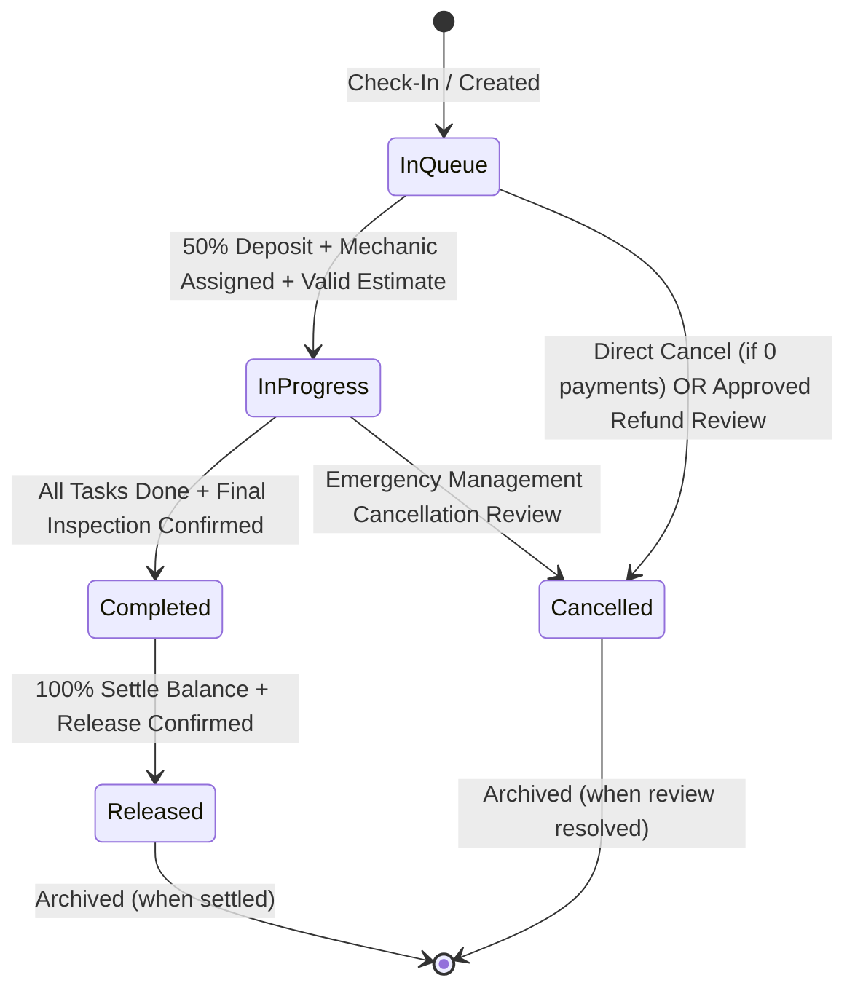

# RevCare Auto Hub CRM Legacy — Workshop Transaction & Lifecycle Rules

## 1. Overview & Purpose

This document provides the definitive, production-level operational and architectural specification for the RevCare Auto Hub CRM Legacy workshop transactional lifecycle. These rules govern Job Orders, Job Tasks (Services), Mechanic Assignments, Financial Billings, Cancellation Reviews, and Record Archiving across `CrmTransactionsForm`, `MasterCrmDbContext`, and supporting domain and infrastructure services.

---

## 2. Job Order Operational Lifecycle



### Stage 1: In Queue (`In Queue` / `Waiting`)
- **Entry Conditions:**
  - Created via Intake from Customer / Vehicle.
  - Created from Inquiries (lead conversion).
  - Created from Workshop Appointments via `[ Check In / Create Job ]`.
- **Requirements:**
  - Must have a linked active `Customer`.
  - Must have at least one requested service (which creates linked `JobTask` items in `Pending` state).
  - Estimate Reference: auto-formatted as `EST-{JobOrderId:D6}` upon database persistence.
- **Allowed Actions:**
  - Add / edit services (cannot remove services with existing work history).
  - Assign or reassign eligible mechanics.
  - Receive initial downpayments / deposits.
  - Direct cancellation (permitted **only** if zero payments have been recorded).
  - If payments exist, cancellation requires formal managerial review via `JobCancellationRequest`.
- **Prohibitions:**
  - Starting tasks (`Ongoing`) or completing tasks (`Done`) is strictly rejected while `In Queue`.
  - Archiving is prohibited.

### Stage 2: In Progress (`In Progress`)
- **Transition Prerequisites (Validated via `WorkshopReadinessService.EvaluateStartWork`):**
  1. **Valid Estimated Cost:** Must be non-zero and properly formatted (`cost > 0`).
  2. **50% Deposit Rule:** Valid cumulative payments (`TotalPaid`) must equal or exceed 50% of the total estimated cost (`TotalEstimatedCost * 0.50m`).
  3. **Assigned Mechanic:** An eligible workshop staff member with matching specialty must be assigned (`AssignedMechanicUserId != null`). If unassigned, the system prompts the user to select an active mechanic immediately.
- **Allowed Actions:**
  - Execute service tasks (update progress to `Ongoing` or `Done`).
  - Withdraw unperformed tasks with recorded reasons.
  - Reassign mechanic (if original mechanic becomes unavailable or specialty change is required).
  - Receive progress payments.
- **Prohibitions:**
  - Skipping directly to `Completed` without finishing all tasks and performing final inspection.
  - Direct cancellation without managerial review.
  - Archiving is prohibited.

### Stage 3: Completed (`Completed`)
- **Transition Prerequisites (Validated via `WorkshopReadinessService.EvaluateCompleteJob`):**
  1. **All Active Tasks Done:** Every linked non-withdrawn/non-cancelled `JobTask` must have status `Done`.
  2. **Final Inspection Confirmation:** The workshop supervisor or quality inspector must explicitly confirm that final road/bay inspection passed (`FinalInspectionConfirmed = true`).
  3. **Timestamp Recording:** `CompletedAt` is recorded in workshop local time (Singapore/Manila Standard Time, UTC+8), enabling lead time and turnaround hour computation.
- **Prohibitions:**
  - Cannot add new services or modify completed service tasks.
  - Cannot reassign mechanics on completed jobs.
  - Releasing vehicle without full settlement is blocked.
  - Archiving is prohibited while unreleased.

### Stage 4: Released (`Released`)
- **Transition Prerequisites (Validated via `WorkshopReadinessService.EvaluateReleaseVehicle`):**
  1. **Full Financial Settlement:** Outstanding balance (`Math.Max(0, TotalEstimatedCost - TotalPaid)`) must be exactly `0.00`.
  2. **Excess Overpayment Policy:** Any payment exceeding the estimated cost is credited to the customer account (`CustomerCredit`).
  3. **Saved Receipts Immutability:** Saved receipt amounts and payment methods cannot be edited or un-paid.
- **Post-Release State:**
  - Vehicle released to customer.
  - Job Order is permanently closed from operational modifications.
  - Fully eligible for soft-archiving once settled.

### Stage 5: Cancelled (`Cancelled`)
- **Direct Cancellation:**
  - Permitted only for unpaid `In Queue` jobs.
  - Requires mandatory non-empty reason.
  - Automatically transitions all unfinished linked tasks to `Cancelled`.
- **Managerial Cancellation Review:**
  - Mandatory for any job with recorded payments or in-progress work.
  - Submitted as `JobCancellationRequest` with requested refund amount and justification.
  - Manager approves or adjusts approved refund ceiling.
  - Once approved refunds are disbursed, job transitions to `Cancelled`.
  - Eligible for soft-archiving once refund review is resolved.

---

## 3. Mechanic Eligibility & Specialty Compatibility Rules

Only active workshop staff members with authorized roles may be assigned to Job Orders:

| Staff Role | Eligibility | Permitted Job Categories |
| :--- | :---: | :--- |
| **Lead Mechanic** | **Eligible** | All categories: Mechanical, Detailing, Mixed / Electrical |
| **Automotive Mechanic** | **Eligible** | Mechanical only (Engine, Brakes, Transmission, Suspension, Tires) |
| **Detailing Technician** | **Eligible** | Detailing only (Wash, Buffing, Interior/Exterior Detailing, Paint Protection) |
| **Service Advisor** | Ineligible | Front-desk only. Cannot be assigned to workshop execution. |
| **Cashier** | Ineligible | Billing and cashiering only. |
| **Inactive Staff** | Ineligible | Inactive members are rejected across all assignments. |

- **One Responsible Mechanic Rule:** One lead/technician is assigned primary operational responsibility for the entire Job Order and its associated tasks.
- **Inline Assignment & Guidance:** In the Edit Job Order dialog, the Assigned Mechanic field is clearly displayed on both the left and right columns. If work is started without an assigned mechanic, RevCare prompts the user with a single-click assignment shortcut.

---

## 4. In-Place Job Task Progress Management

Per user directive, task status updates must occur directly on the active page without navigating to separate panes or disjoint editors:

1. **Main Module (`JobTaskPage`):**
   - `[ ✓ Mark Done ]`: Immediately marks the selected task `Done` (validates task is currently `Ongoing`).
   - `[ ▶ Start Task ]`: Sets the selected task to `Ongoing` (from `Pending`).
   - `[ ⚡ Mark ALL Done ]`: Atomically marks all eligible ongoing tasks for the selected job order as `Done` with mandatory user confirmation. Blocks if any active task is still `Pending`.
   - **Grid Double-Click:** Selects the row safely without mutating task state. Unsafe status cycling has been removed.
2. **Pop-up View (`JobTasksDialogForm`):**
   - Prominently displays job details, vehicle, estimate, and mechanic in the header.
   - Includes `[ ⚡ Mark ALL Done ]`, `[ ✓ Mark Done ]`, and `[ ▶ Start Task ]`. `btnMarkAllOngoing` has been permanently removed.
   - Real-time task progress computation: `(Completed Tasks / Active Tasks) * 100` (excluding withdrawn/cancelled tasks).
   - In-cell editing for `Remarks` / Inspection Notes auto-saves upon row commit. Closed or archived jobs lock remarks as read-only.

### Strict Progressive Task Lifecycle
- **Permitted Progression:** `Pending` → `Ongoing` → `Done`.
- **Prohibited Reversals:**
  - `Done` → `Pending` is strictly prohibited.
  - `Done` → `Ongoing` is strictly prohibited.
  - `Ongoing` → `Pending` is strictly prohibited.
  - Reversing completed task status throws an `InvalidOperationException` at the persistence boundary in `WorkshopRules.Validate()`.
- **Immutable Task Identity:** Task `ServiceId` and `JobOrderId` cannot be modified after initial creation.

### Protection of Closed and Archived Records
- **Completed / Released Jobs:** Modifying task status or editing inspection remarks on closed jobs is strictly blocked. Adding new tasks is rejected.
- **Cancelled Jobs:** Tasks under cancelled jobs cannot be modified or have remarks edited.
- **Archived Jobs:** Any modification or addition to tasks or remarks under archived job orders is permanently blocked.
- **Active Cancellation Reviews:** While a cancellation request is pending review, task addition or modification is suspended.

---

## 5. Record Archiving & Soft-Delete Specification

### Permanent Deletion Prohibition
- **Zero Physical Deletes:** Physical `DELETE` SQL operations on `JobOrders` and `JobTasks` are strictly prohibited.
- **Persistence Interception:** `WorkshopRules.Validate()` intercepts `EntityState.Deleted` on `JobOrder` and `JobTask` and throws `InvalidOperationException`.
- **UI Interception:** The UI delete button is repurposed to `[ 📦 Archive Selected Job Order ]` / `[ 📦 Archive / Withdraw Task ]`. If permanent delete is invoked programmatically, it throws an exception directing to archiving.

### Additive Archival Schema
Both `JobOrders` and `JobTasks` support additive archiving columns:
- `IsArchived` (`bit`, default `0`, indexed `IX_JobOrders_IsArchived`, `IX_JobTasks_IsArchived`)
- `ArchivedAtUtc` (`datetime2`, nullable)
- `ArchivedBy` (`nvarchar(100)`, nullable)
- `ArchiveReason` (`nvarchar(500)`, nullable)

### Archival Eligibility Rules (`WorkshopReadinessService.EvaluateArchive`)
- **Eligible:**
  1. `Status == "Released"` AND `OutstandingBalance <= 0`.
  2. `Status == "Cancelled"` AND No active pending cancellation review / pending refund.
  3. Non-empty mandatory archival reason (minimum 5 characters).
- **Ineligible (Blocked):**
  - `In Queue` or `In Progress` (active workshop operations cannot be archived).
  - `Completed` but not yet `Released` (vehicle still in workshop premises).
  - Outstanding balance unpaid.
  - Active cancellation review or pending refund disbursement.

### Restoration Rules (`WorkshopReadinessService.EvaluateRestore`)
- Must currently have `IsArchived == true`.
- Requires mandatory non-empty restoration reason.
- Atomic restore resets `IsArchived = false`, clears archive metadata, and logs an immutable `AuditEntry` (`Action = "Restored"`).
- Operational status (`Released`, `Cancelled`) is strictly preserved upon restore.

---

## 6. Resilient Database & Transaction Protocols

- **Execution Strategy Integration:** RevCare operates on SQL Server with `EnableRetryOnFailure`. Manual `db.Database.BeginTransaction()` calls outside the execution strategy fail.
- **Standardized Execution Strategy Pattern:**
  ```csharp
  var strategy = db.Database.CreateExecutionStrategy();
  await strategy.ExecuteAsync(async () =>
  {
      using var innerDb = factory();
      await using var tx = await innerDb.Database.BeginTransactionAsync(IsolationLevel.Serializable);
      // Concurrency lock
      var job = await innerDb.JobOrders
          .FromSqlInterpolated($"SELECT * FROM JobOrders WITH (UPDLOCK, HOLDLOCK) WHERE JobOrderId = {id}")
          .SingleOrDefaultAsync();
      // Business rules & persistence
      innerDb.AuditEntries.Add(new AuditEntry { ... });
      await innerDb.SaveChangesAsync();
      await tx.CommitAsync();
  });
  ```
- **Single-Context Saves:** In dialogs with single atomic saves (`AppointmentManagerDialogForm`, `InquiryDialogForm`), explicit `BeginTransaction` is omitted, allowing `MasterCrmDbContext.SaveChanges()` to coordinate its built-in serializable execution strategy transaction cleanly.
