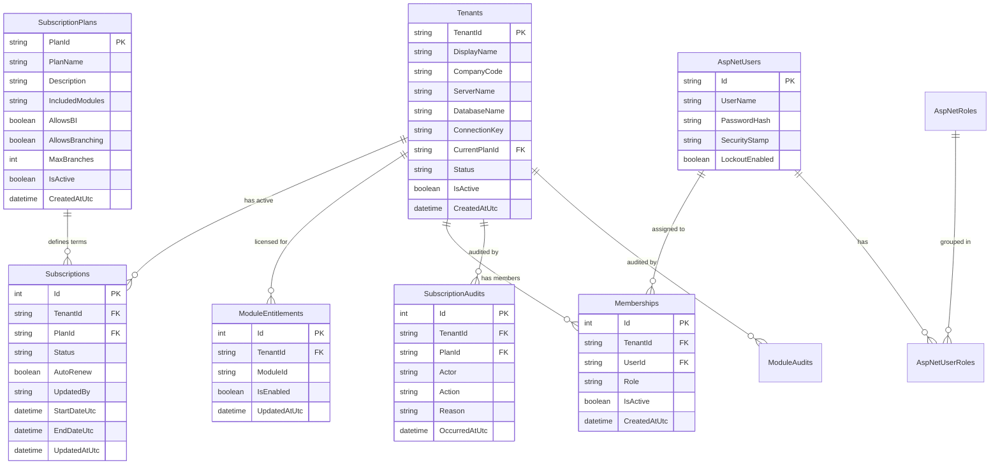
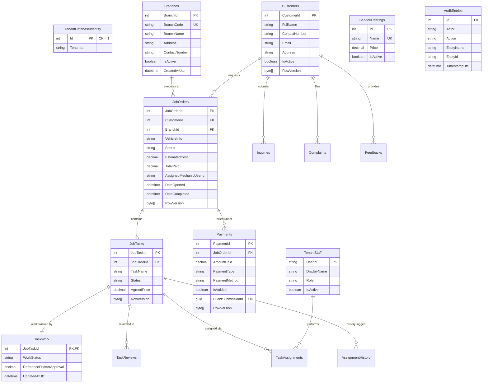
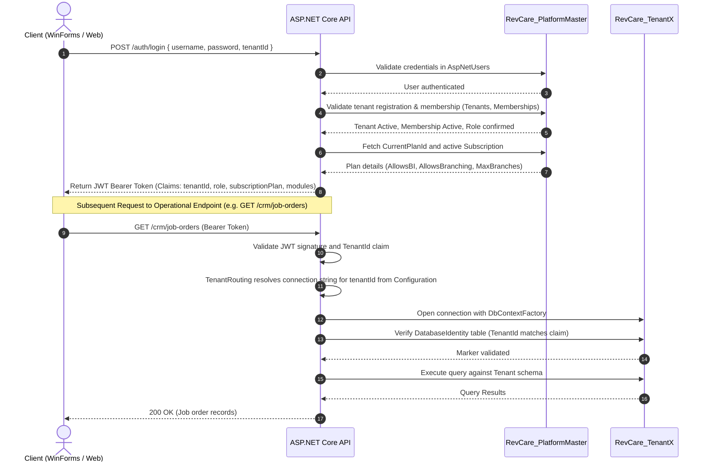

# RevCare CRM — Local Multi-Tenant Database Architecture

**Date:** November 2026  
**Solution:** RevCare Auto Hub CRM (.NET 10, ASP.NET Core Web API, EF Core, SQL Server LocalDB)  
**Workspace:** `C:\Users\alexi\source\repos\CRM_Revcare`  
**Target Environment:** Local Development (`(localdb)\MSSQLLocalDB`)

---

## 1. Executive Summary

RevCare CRM employs a secure **Database-per-Company** architecture governed by a centralized **Platform Master Database** (`RevCare_PlatformMaster`). This design establishes complete physical and logical data isolation across separate automotive repair companies while maintaining centralized tenant registration, user authentication, subscription plan enforcement, and technical administration.

Key architectural characteristics:
- **Three Independent Companies:**
  - **Company A (`tenant-a`):** "RevCare Auto Hub" — Authoritative operational database hosting the primary production workshop records (220 Job Orders, 209 Customers, 202 Vehicles, 229 Job Tasks, 223 Payments).
  - **Company B (`tenant-b`):** "RevCare Tenant B" — Independent automotive company operating on its own isolated database (`RevCare_TenantB`), subscribed to Plan B (Professional BI).
  - **Company C (`tenant-c`):** "RevCare Tenant C" — Independent multi-branch automotive company operating on a single company database (`RevCare_TenantC`) with relational branch isolation (`MAIN`, `NORTH`, `SOUTH`), subscribed to Plan C (Enterprise Multi-Branch).
- **Strict Data Isolation:** Operational records (customers, vehicles, staff, catalogs, inquiries, appointments, job orders, tasks, payments, feedback, refunds, archives) are never shared between companies.
- **Subscription Decoupling:** Subscription tiers (`PlanA`, `PlanB`, `PlanC`) govern access to features (Business Intelligence, Branch Management) via metadata claims and policy evaluations. Upgrading a plan updates metadata in Platform Master without physical record relocation.
- **Single-DB Multi-Branching for Tenant C:** Enterprise multi-branch companies operate multiple branches within one company database, partitioned by relational branch ownership (`BranchId`).
- **Isolated Migration Histories:** Platform Master and Tenant CRM maintain separate EF Core migration pipelines. Legacy CRM migration tables remain untouched.
- **Zero-Modification Data Preservation:** The authoritative production dataset in `DB_MasterCrm` and all baseline backups are preserved without physical deletion, renumbering, or destructive modification.

---

## 2. Actual Local Database Inventory

All active databases reside on `(localdb)\MSSQLLocalDB`.

| Database Name | Role / Tenant | Plan | State | Migration Version | Key Data / Baseline |
| :--- | :--- | :--- | :--- | :--- | :--- |
| **`RevCare_PlatformMaster`** | Platform Master | Platform Administration | ONLINE | `20261124062726_AddSubscriptionPlansAndCompanyMaster` (4 migrations) | 3 Registered Tenants (`tenant-a`, `tenant-b`, `tenant-c`), 3 Subscription Plans, 4 Identity Users (`superadmin`, `owner`, `owner_b`, `owner_c`), 3 Active Memberships |
| **`DB_MasterCrm`** | Company A (`tenant-a`) Authoritative Operational DB | Plan A (Core Transactions) | ONLINE | `20261124100231_AddJobOrderAndTaskArchiving` (12 migrations) | **Authoritative Production Records:** 220 Job Orders, 209 Customers, 202 Vehicles, 217 Estimates, 229 Job Tasks, 223 Payments, 207 Inquiries, 204 Feedbacks, 203 Complaints, 15 Staff |
| **`RevCare_TenantA`** | Tenant A Baseline / Test Prototype | Plan A (Prototyping Baseline) | ONLINE | `20261124062717_AddTenantBranchFoundation` (7 migrations) | **Preserved Baseline:** 1 Customer, 1 JobOrder, 1 Payment, 1 Default Branch (`MAIN`). Read-only snapshot preserved in `RevCare_TenantA_Baseline.bak` |
| **`RevCare_TenantB`** | Company B (`tenant-b`) | Plan B (Professional BI & Analytics) | ONLINE | `20261124062717_AddTenantBranchFoundation` (7 migrations) | 0 Customers, 0 JobOrders, 1 Default Branch (`MAIN`). Ready for independent onboarding |
| **`RevCare_TenantC`** | Company C (`tenant-c`) Multi-Branch | Plan C (Enterprise Multi-Branch & Analytics) | ONLINE | `20261124062717_AddTenantBranchFoundation` (7 migrations) | Single company DB with 3 Branches (`MAIN`, `NORTH`, `SOUTH`). Ready for multi-branch operations |

---

## 3. Subscription Entitlement Matrix

The subscription engine separates tenant identity from subscription tier. Upgrading a subscription simply updates the tenant's `CurrentPlanId` in `RevCare_PlatformMaster.dbo.Tenants` and inserts an audit log entry.

| Capability / Module | Plan A (Starter) | Plan B (Professional) | Plan C (Enterprise) | Enforcement Mechanism |
| :--- | :---: | :---: | :---: | :--- |
| **Main Transactions (Job Orders, Tasks, Work)** | Yes | Yes | Yes | `TenantCrmDbContext` & `TenantPermissions` |
| **Data Collection (Inquiries, Leads, Customers)** | Yes | Yes | Yes | `TenantPermissions` |
| **Payments, Receipts & Invoicing** | Yes | Yes | Yes | `WorkshopRules` & `TenantPermissions` |
| **Service Catalog Management** | Yes | Yes | Yes | Service Offering endpoints |
| **Staff & Task Review Workflow (QA)** | Yes | Yes | Yes | TaskReview state machine |
| **Business Intelligence (BI) & 6 KPI Graphs** | **No (403 Forbidden)** | **Yes (200 OK)** | **Yes (200 OK)** | `BackendAccess.ValidateSubscriptionAccess` |
| **Analytical Reports & Retention Insights** | **No (403 Forbidden)** | **Yes (200 OK)** | **Yes (200 OK)** | Module claim `BusinessIntelligence` |
| **Branch Management (`/crm/branches`)** | **No (403 Forbidden)** | **No (403 Forbidden)** | **Yes (200 OK)** | Module claim `Branching` |
| **Multi-Branch Operations in Single DB** | Single Default Branch | Single Default Branch | **Multiple Branches** (MAIN, NORTH, SOUTH) | `AllowsBranching` flag & `MaxBranches` |
| **Max Allowed Branches** | 1 | 1 | 999 | `SubscriptionPlans.MaxBranches` |

---

## 4. Entity-Relationship Diagrams

### 4.1 Master Database Schema (`RevCare_PlatformMaster`)

### 4.2 Shared Tenant Database Schema (`RevCare_TenantA`, `RevCare_TenantB`, `RevCare_TenantC`)

---

## 5. Tenant Database Resolution & Routing Workflow

### Security Invariants Enforced:
1. **No Client Database Credentials:** The client never receives SQL connection strings or database server names; it communicates exclusively over HTTPS via JWT bearer tokens.
2. **Identity Marker Verification:** Each tenant database has a singleton table `TenantDatabaseIdentity` (guaranteed single-row via SQL check constraint `[Id] = 1`). On each request, EF Core validates that the target database's `TenantId` matches the authenticated claim.
3. **Cross-Tenant Barrier:** Attempting to use a token for `tenant-a` against `tenant-b`'s connection throws a 403 Forbidden or 409 Conflict.
4. **Super Admin Isolation:** Super Admins hold administrative platform rights in `RevCare_PlatformMaster` but have no implicit access to query operational customer records in tenant databases.

---

## 6. Migration History

### Platform Master Migrations
Assembly: `CRM.infrastructure`  
DbContext: `PlatformMasterDbContext`  
Migration table: `RevCare_PlatformMaster.dbo.__EFMigrationsHistory`

1. `20261119085638_InitialPlatformMaster` — Initial Master Identity schema (AspNetUsers, AspNetRoles, Tenants, Memberships).
2. `20261119151727_TenantAStaffAccess` — Added staff access synchronization tables.
3. `20261120025019_TenantProvisioningAndModules` — Module catalog, licensing entitlements, and module audit history.
4. `20261124062726_AddSubscriptionPlansAndCompanyMaster` — Added `SubscriptionPlans`, `Subscriptions` (`TenantSubscription`), `SubscriptionAudits`, and enriched `Tenants` with `CompanyCode`, `ServerName`, `DatabaseName`, and `CurrentPlanId`.

### Shared Tenant Migrations
Assembly: `CRM.infrastructure`  
DbContext: `TenantCrmDbContext`  
Migration table: `dbo.__EFMigrationsHistory` in `RevCare_TenantA`, `RevCare_TenantB`, and `RevCare_TenantC`

1. `20261116144348_InitialTenantCrm` — Core customer, job order, task, payment, and audit tables.
2. `20261119085655_TenantAWorkshop` — Workshop rules, status models, and pricing snapshot rules.
3. `20261119151743_TenantAWorkforce` — Tenant staff, task assignments, and assignment history.
4. `20261119171506_TaskReviewWorkflow` — QA submission, review notes, inspection, and rework tracking.
5. `20261122102731_AddJobOrderAssignedMechanic` — Mechanic assignment snapshot on job orders.
6. `20261122115509_AddJobOrderAssignedMechanicUserId` — User ID foreign-key linkage for assigned mechanics.
7. `20261124062717_AddTenantBranchFoundation` — Multi-branch support (`Branches` table: `BranchId`, `BranchCode`, `BranchName`, `Address`, `ContactNumber`, `IsActive`, `CreatedAtUtc`).
8. `20261124131459_AlignTenantCrmWithOperationalSchema` — Full 3NF operational alignment: restored `Vehicles`, `Estimates`, `EstimateLines`, `Appointments`, `AppointmentHistories`, `JobCancellationRequests`, `Refunds`, added soft archiving (`IsArchived`, `ArchivedAtUtc`, `ArchivedBy`, `ArchiveReason`) on `JobOrders` and `JobTasks`, added agreed price and service name snapshots.

### Company A (DB_MasterCrm) Migrations
Assembly: `CRM.infrastructure`  
DbContext: `MasterCrmDbContext`  
Migration table: `DB_MasterCrm.dbo.__EFMigrationsHistory`

1. `20261116104009_InitialCreate` — Initial CRM Legacy database creation.
2. `20261116144339_AddCredentialKeyToCompanyDatabase` — Added CompanyDatabase credential key column.
3. `20261117152553_AddCoreBusinessTransactions` — Added core business transaction entities (Inquiries, Complaints, Feedbacks).
4. `20261118000100_AddCoreTransactionCreatedAt` — Added transaction creation timestamps.
5. `20261118072516_AddCustomerRecords` — Normalized customer record storage.
6. `20261118164718_WorkshopBusinessRules` — Hardened 50% downpayment, task progress, and release rules.
7. `20261118193905_TransactionProtection` — Concurrency protection and serializable transaction rules.
8. `20261122102718_AddJobOrderAssignedMechanic` — Mechanic assignment snapshot on job orders.
9. `20261122115453_AddJobOrderAssignedMechanicUserIdAndStaffDirectory` — Staff directory with specialty roles and mechanic user ID linkage.
10. `20261123150822_LegacyNormalization3NF` — Third normal form relational normalization (Vehicles, Estimates, EstimateLines, Appointments).
11. `20261124033501_AddJobCancellationRefundsAndAppointmentHistory` — Added `JobCancellationRequests`, `Refunds`, and `AppointmentHistories`.
12. `20261124100231_AddJobOrderAndTaskArchiving` — Additive archiving columns (`IsArchived`, `ArchivedAtUtc`, `ArchivedBy`, `ArchiveReason`) on `JobOrders` and `JobTasks`.
13. `20261124131444_AddTenantIdentityAndBranchesToMasterCrm` — Additive multi-company alignment: added `TenantDatabaseIdentity` table with `[Id]=1` singleton constraint, `Branches` table with default `MAIN` branch, and nullable `BranchId` on `JobOrders`, `Appointments`, and `Payments`. Tested on disposable databases prior to production cutover.

---

## 7. Authoritative Transition & Shared Operational Foundation

Under the Phase 1 Architectural Decision, **CRM Legacy becomes Company A (`tenant-a`)**. The 220 Job Orders, 209 Customers, 202 Vehicles, 229 Job Tasks, 223 Payments, 217 Estimates, 207 Inquiries, 204 Feedbacks, 203 Complaints, and 15 Staff in `DB_MasterCrm` represent the authoritative operational dataset of Company A (RevCare Auto Hub).

### Architectural Convergence Strategy:
1. **Authoritative Registration (Option 1):** `DB_MasterCrm` is registered as the authoritative writable database for `tenant-a` in `PlatformMaster.dbo.Tenants`.
2. **Schema Unification:** Rather than degrading Company A's data to fit the simplified tenant prototype, the rich, hardened `MasterCrmDbContext` schema (with 3NF Vehicles, Estimates, Appointments, Cancellation/Refunds, and Archiving) serves as the operational target for all company databases (Company B, Company C).
3. **Single Authoritative Writable Copy:** Company A has exactly one writable database (`DB_MasterCrm`). The prototype database `RevCare_TenantA` is retired to cold backup.
4. **Independent Company Databases:** Company B (`RevCare_TenantB`) and Company C (`RevCare_TenantC`) run on their own physical databases, sharing identical business rules and application code while ensuring 100% data isolation.
5. **Tenant C Branching:** Company C operates multiple branches (`MAIN`, `NORTH`, `SOUTH`) within its single company database using `BranchId` row-level partitioning.

---

## 8. Database Safety & Preservation Record

1. **`DB_MasterCrm` (Company A Authoritative):**
   - Active operational records: 220 Job Orders, 209 Customers, 202 Vehicles, 217 Estimates, 229 Job Tasks, 223 Payments, 207 Inquiries, 204 Feedbacks, 203 Complaints, 15 Staff.
   - All historical record identities, timestamps, and payment ledgers preserved intact.
   - Zero destructive physical deletions or unapproved reseed operations.
2. **`RevCare_TenantA` (Test Prototype):**
   - Preserved baseline snapshot: `C:\Users\alexi\AppData\Local\Temp\RevCare_TenantA_Baseline.bak` (1 Customer, 1 JobOrder, 1 Payment).
   - Preserved without overwrite during Phase 1 assessment.
3. **`RevCare_TenantB` & `RevCare_TenantC`:**
   - Database schemas preserved with 7 migrations; isolated and ready for Company B and Company C onboarding.
4. **Cloud Databases:**
   - No connections opened to cloud instances (`db80735`, `db81188`, `db81189`).
   - Local development strictly confined to `(localdb)\MSSQLLocalDB`.

---

## 9. Phase 3: Backend Authentication, Branch Authorization & Company Routing Status

Phase 3 has been fully implemented, hardened, and verified with zero operational database modifications:
1. **Specialized Workshop Roles:** `OwnerManager`, `BranchManager`, `ServiceAdvisor`, `LeadMechanic`, `AutomotiveMechanic`, and `DetailingTechnician` are fully enforced in `TenantPermissions.cs` with exact privilege boundaries.
2. **Super Admin Isolation:** Platform Super Administrators are granted access only to platform administrative endpoints (`/master/*`). Calls to company workshop or financial endpoints (`/crm/*`) return `HTTP 403 Forbidden`.
3. **Branch-Scoped Data Isolation:** Branch staff and managers in `Tenant C` (e.g. `NORTH` vs `SOUTH`) are strictly isolated to their assigned branch records. Cross-branch operations (retrieving, updating, deleting jobs, or recording payments) return `403 Forbidden` or `404 Not Found`. Client-side branch parameter tampering is neutralized by server-side claim enforcement.
4. **Parent-Child Branch Consistency:** Enforced at the DbContext level in `TenantCrmDbContext.Rules.cs`. Cross-branch payments and appointments fail closed with structured `InvalidOperationException` errors.
5. **WinForms Session Display & Logout:** Displays `Company: {CompanyName} | User: {Username} | Role: {Role} | Branch: {Branch} | Env: Development`. Logout cleanly disposes contexts and clears bearer authentication headers.
6. **Reference Specification:** Full details are documented in [docs/AUTHENTICATION_AND_TENANT_SECURITY.md](file:///c:/Users/alexi/source/repos/CRM_Revcare/docs/AUTHENTICATION_AND_TENANT_SECURITY.md).

