# RevCare CRM — Tenant A Demonstration & Walkthrough Guide

**Date:** Thursday, November 26, 2026  
**Target Solution:** RevCare Auto Hub CRM (.NET 10, Windows Forms, ASP.NET Core Web API, EF Core)  
**Scope:** Authenticated Tenant A Local Operational Demonstration  

---

## 1. Demonstration Overview

This guide details the end-to-end walkthrough for demonstrating **Tenant A** operating under secure authentication, multi-tenant company routing, and full workshop operational lifecycle enforcement.

All tests and demonstration fixtures execute against isolated local databases (`(localdb)\MSSQLLocalDB`) with zero risk to production data.

---

## 2. Automated Smoke & Regression Verification

Before starting the interactive UI walkthrough, run the automated verification suites to demonstrate 100% compliance across all architectural layers:

```powershell
# 1. Backend API & Multi-Actor Acceptance Suite (261 Checks Passed)
dotnet run --project tests/Backend.Smoke

# 2. Workshop Domain Business Rules Suite (211 Checks Passed)
dotnet run --project tests/BusinessRules.Smoke

# 3. Comprehensive UI, Regression & Native Backup Rehearsal (346 Checks Passed)
dotnet run --project tests/Verification.Smoke

# 4. Clean Release Build Verification (0 Errors, 0 Warnings)
dotnet build CRM_Revcare.slnx -c Release
```

---

## 3. Actor Roles & Credentials Matrix

| Actor Role | Username | Test Password | Accessible Modules & Permissions | Strict Operational Restrictions |
|---|---|---|---|---|
| **Super Admin** | `superadmin` | `Test-only!Master2026` | Platform Master administration, tenant provisioning, subscription tiers, module catalogs. | **Cannot** access tenant customer profiles, job orders, tasks, or payments. |
| **Owner / Manager** | `owner` | `Test-only!Staff2026` | All Tenant A modules: Customers, Inquiries, Appointments, Estimates, Job Orders, Tasks, Payments, Refunds, Staff, Reports. | Cannot manage SuperAdmin credentials or access other tenant databases. |
| **Service Advisor** | `advisor` / `ServiceAdvisor` | `Test-only!Staff2026` | Customers, Vehicles, Inquiries, Appointments, Estimates, Terms Acceptance, Insurance Claims, Receipts, Vehicle Release. | **Cannot** manage staff, void payments, reassign mechanics, or change catalog prices. |
| **Lead Mechanic** | `leadmechanic` / `LeadMechanic` | `Test-only!Staff2026` | Workshop Queue, Authorized Work Orders, Mechanic Assignment, Task QA Review / Rework, Job Completion. | **Cannot** access customer contact information, billing totals, payments, or receipts. |
| **Automotive Mechanic** | `mechanic` / `AutomotiveMechanic` | `Test-only!Staff2026` | Assigned Work Orders, Mechanical Task Progress (Pending → Ongoing → Done → Submit). | **Cannot** access billing/receipts, unassigned jobs, or detailing tasks in mixed jobs. |
| **Detailing Technician** | `detailer` / `DetailingTechnician` | `Test-only!Staff2026` | Assigned Work Orders, Detailing Task Progress (Pending → Ongoing → Done → Submit). | **Cannot** access billing/receipts, unassigned jobs, or mechanical tasks. |

---

## 4. The 20-Step Connected Multi-Actor Demonstration Script

This 20-step transaction acceptance test matches the automated verification executed in `RunTwentyStepAcceptanceTest`:

```mermaid
flowchart TD
    S1["1. Super Admin: Tenant Health & Catalog"] --> S2["2. Owner: Staff Verification"]
    S2 --> S3["3. Service Advisor: Authentication"]
    S3 --> S4["4. Advisor: Customer & Vehicle Intake"]
    S4 --> S5["5. Advisor: Book Appointment"]
    S5 --> S6["6. Advisor: Appointment Check-in (Job Order #Queue)"]
    S6 --> S7["7. Advisor: Create Multi-line Estimate (₱12,000)"]
    S7 --> S8["8. Customer & Advisor: Estimate Approval & Duplicate-Free Conversion"]
    S8 --> S9["9. Customer: Terms & Conditions Acceptance (v1.1)"]
    S9 --> S10["10. Advisor: File Insurance Claim (CLM-E2E-7788)"]
    S10 --> S11["11. Insurer: Coverage Approval (Non-Payment Rule Enforced)"]
    S11 --> S12["12. Customer: 50% Cash Downpayment (₱6,000 Receipt)"]
    S12 --> S13["13. Lead Mechanic: Assignment & Transition to In Progress"]
    S13 --> S14["14. Lead Mechanic: Retrieve Authorized Work Order"]
    S14 --> S15["15. Technician: Task 1 Execution (Ongoing -> Done -> Submit)"]
    S15 --> S16["16. Technician: Task 2 Execution (Ongoing -> Done -> Submit)"]
    S16 --> S17["17. Lead Mechanic: QA Rework Loop & Job Completion"]
    S17 --> S18["18. Insurer & Customer: Remittance & Final Settlement (₱0.00 Balance)"]
    S18 --> S19["19. Advisor: Vehicle Release Signoff"]
    S19 --> S20["20. Advisor: 3-Day Follow-up, 5-Star Feedback & Operational Reports"]
```



### Step-by-Step Execution Guide:

1. **Step 1: Platform Health & Catalog Inspection (Super Admin)**
   - Authenticate as `superadmin`.
   - Call `GET /master/tenants` -> Confirm `tenant-a` is Active and Ready.
   - Call `GET /master/modules` -> Inspect platform module catalog.

2. **Step 2: Staff Status Verification (Owner / Manager)**
   - Authenticate as `owner`.
   - Call `GET /crm/staff` -> Verify `ServiceAdvisor` and `LeadMechanic` profiles are active.

3. **Step 3: Service Advisor Authentication (Service Advisor)**
   - Authenticate as `ServiceAdvisor` with bearer access token.
   - Confirm active session scoped to Tenant A (`MAIN` branch).

4. **Step 4: Customer Intake & Vehicle Registration (Service Advisor)**
   - Register customer: Carlos Mendoza (`0917-555-4321`, `carlos.mendoza@revcare.ph`).
   - Register vehicle: Toyota Fortuner 2023 (`NBD-7788`, VIN `VIN-E2E-7788`).

5. **Step 5: Appointment Scheduling (Service Advisor)**
   - Book appointment: Scheduled start 2 hours ahead, requested services: `"Engine Valve Grinding & Gaskets; Full Exterior Detailing & Ceramic Coat"`.

6. **Step 6: Atomic Appointment Check-in (Service Advisor)**
   - Execute `POST /crm/appointments/{id}/check-in`.
   - Verify: Atomic creation of queued Job Order with vehicle intake notes. Re-checkin is rejected (idempotent).

7. **Step 7: Estimate Authoring (Service Advisor)**
   - Create Estimate:
     - Line 1: `"Engine Valve Grinding & Gaskets"`, Qty: 1, Price: ₱8,000.00.
     - Line 2: `"Full Exterior Detailing & Ceramic Coat"`, Qty: 1, Price: ₱4,000.00.
     - Total: ₱12,000.00.

8. **Step 8: Estimate Approval & Duplicate-Free Conversion (Service Advisor)**
   - Customer approves estimate (`POST /crm/estimates/{id}/approve`).
   - Advisor converts estimate (`POST /crm/estimates/{id}/convert`).
   - **Verification:** Duplicate prevention logic detects existing queued Job Order from Step 6, links tasks into existing Job Order, and creates **zero duplicate job orders**.

9. **Step 9: Versioned Terms & Conditions Acceptance (Customer & Advisor)**
   - Publish & activate version `v1.1` (`PUT /crm/terms/v1.1/activate`).
   - Record customer acceptance: `POST /crm/job-orders/{id}/terms-acceptance` with version `v1.1`, customer acknowledgement flag, and digital intake method.

10. **Step 10: Insurance Claim Filing (Service Advisor)**
    - File claim: Policy `POL-REV-9921`, Insurer `Malayan Insurance`, Incident date `2026-11-20`, Deductible `₱2,000`, Estimated damage `₱12,000`.

11. **Step 11: Insurance Coverage Approval & Non-Payment Rule (Insurer)**
    - Adjuster approves coverage of ₱6,000.
    - **Crucial Rule Enforcement:** `JobOrder.TotalPaid` remains ₱0.00! Approved coverage does NOT count as payment; outstanding balance remains ₱12,000.00.

12. **Step 12: Mandatory 50% Downpayment (Customer & Cashier)**
    - Customer settles ₱6,000 cash downpayment (`POST /crm/payments`).
    - Validate official cash receipt issued with itemized details and ₱6,000 total paid.

13. **Step 13: Whole-Job Assignment & Work Commencement (Lead Mechanic)**
    - Assign qualified `LeadMechanic` as whole-job owner (`PUT /crm/job-orders/{id}/assignment`).
    - Transition Job Order to `"In Progress"` (`PUT /crm/job-orders/{id}/status`).

14. **Step 14: Work Order Retrieval (Lead Mechanic)**
    - Authenticate as `LeadMechanic`.
    - Retrieve authorized work order (`GET /crm/workshop/jobs/{id}/work-order`).
    - Verify: Work order contains exactly 2 tasks without exposing billing details.

15. **Step 15: Task 1 Execution & Submission (Technician)**
    - Workshop transitions Task 1 to `"Ongoing"` then `"Done"`.
    - Technician submits Task 1 for QA inspection (`POST /crm/job-tasks/{id}/submit`).

16. **Step 16: Task 2 Execution & Submission (Technician)**
    - Workshop transitions Task 2 to `"Ongoing"` then `"Done"`.
    - Technician submits Task 2 for QA inspection.

17. **Step 17: QA Inspection, Rework Loop & Job Completion (Lead Mechanic)**
    - Lead Mechanic requests rework on Task 1 (`POST /crm/job-tasks/{id}/review` with `Approved = false`, Reason `"Re-torque valve cover bolts"`).
    - Task 1 automatically returns to `"Ongoing"`.
    - Technician re-submits Task 1.
    - Lead Mechanic approves QA on all tasks (`Approved = true`).
    - Lead Mechanic marks Job Order `"Completed"`.

18. **Step 18: Insurance Remittance & Final Balance Settlement (Cashier)**
    - Insurer remits ₱4,000 via Bank Transfer (`PayerType = "Insurance"`).
    - Customer settles remaining ₱2,000 balance via GCash.
    - **Verification:** Total paid equals ₱12,000.00 (₱6,000 downpayment + ₱4,000 insurance + ₱2,000 customer). Outstanding balance settled to ₱0.00.

19. **Step 19: Vehicle Release Sign-off (Service Advisor)**
    - Advance Job Order status to `"Released"` (`PUT /crm/job-orders/{id}/status`).
    - Verify: Release recorded with completion timestamp and gate pass sign-off.

20. **Step 20: Post-Service Follow-up, Feedback & Operational Reports (Service Advisor)**
    - Log scheduled 3-day post-service follow-up.
    - Record 5-star customer feedback rating (`POST /crm/feedbacks`).
    - Query operational summary (`GET /crm/reports/summary`) -> Confirm live metrics reflect completed and released job orders.

---

## 5. Native SQL Server Backup Rehearsal Verification

To prove zero data loss and cutover safety, execute the native rehearsal:

```powershell
dotnet run --project tests/Verification.Smoke
```

Verified rehearsal log results:
- `PASS: Native Backup: Verified 226 Job Orders baseline on DB_MasterCrm`
- `PASS: Native Backup: Verified 232 Payments baseline on DB_MasterCrm`
- `PASS: Native Backup: DB_MasterCrm backup file produced via COPY_ONLY`
- `PASS: Native Backup: Restored database copy initialized via SQL Server RESTORE WITH MOVE`
- `PASS: Native Backup: Restored copy contains exactly 226 Job Orders (226/226)`
- `PASS: Native Backup: Restored copy contains exactly 232 Payments (232/232)`
- `PASS: Native Backup: Restored copy contains exactly 209 Customers (209/209)`
- `PASS: Native Backup: Cutover schema alignment migration successfully applied to restored copy`
- `PASS: Native Backup: Tenant A identity & Branch registered on restored copy without errors`
- `PASS: Native Cutover: TenantCrmDbContext accesses all 226 Job Orders`
- `PASS: Native Cutover: TenantCrmDbContext accesses all 232 Payments`
- `PASS: Native Cutover: TenantCrmDbContext accesses all 209 Customers`
- `PASS: Native Backup: Live operational write successful on cutover database`
- `PASS: Native Backup Safety: DB_MasterCrm Job Orders count completely untouched (226/226)`
- `PASS: Native Backup Safety: DB_MasterCrm Payments count completely untouched (232/232)`
